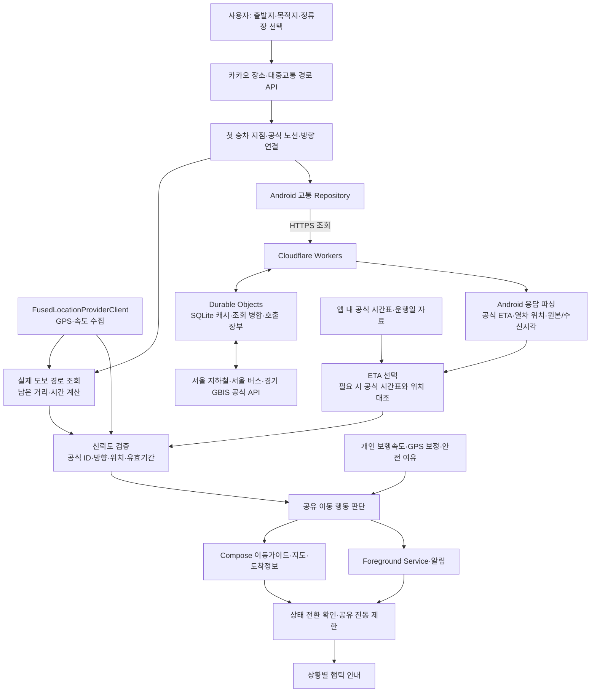

# 탑승의 민족

**실시간 교통정보와 나의 이동 상황을 함께 계산해, 지금 필요한 행동을 안내하는 개인 맞춤형 대중교통 이동 보조 앱입니다.**

차량 도착시간을 확인하는 데서 나아가 **걸을지, 서두를지, 다음 차량을 이용할지**를 알려줍니다. 화면을 계속 확인하기 어려운 이동 중에는 **상황별 진동**으로 안내의 변화를 전달합니다.

- 출발지·목적지 검색부터 최대 3개 대중교통 경로와 첫 승차 지점 연결
- 공식 버스·지하철 ETA와 실제 도보 경로를 비교한 이동가이드
- 개인 걷기 분석, 설정 속도와 GPS를 결합한 도보시간 보정
- 화면이 꺼져도 이어지는 알림과 1·2·3회 / 2초 연속 햅틱 안내

> **문서 기준:** 2026-10-30 한국 시각, `main`에 반영한 앱·Worker 소스 [`9e218b8`](https://github.com/y-willy/run_or_walk/commit/9e218b805bc993d8eaba8b9add4e3de9f2d9c53a) 기준. 현재는 공식 API 연동과 자동화 검증을 진행 중인 Android 프로토타입입니다. 구현 상태, 운영 API 확인, 실기기 검증을 아래에서 구분합니다.
>
> 사용자에게 표시하는 앱 이름은 **탑승의 민족**입니다. 저장소 `y-willy/run_or_walk`, 패키지 `com.example.run_or_walk`, 기존 코드 식별자는 유지합니다.

## 목차

- [개발 배경](#개발-배경)
- [주요 기능과 구현 상태](#주요-기능과-구현-상태)
- [이동 판단과 진동](#이동-판단과-진동)
- [시스템 구조](#시스템-구조)
- [지원 지역과 데이터 정책](#지원-지역과-데이터-정책)
- [현재 검증 결과](#현재-검증-결과)
- [설치 및 APK 빌드](#설치-및-apk-빌드)
- [Worker 설정 및 배포](#worker-설정-및-배포)
- [한계와 발전 계획](#한계와-발전-계획)
- [코드 및 문서 안내](#코드-및-문서-안내)

## 개발 배경

기존 지도 앱에서는 대중교통 도착 예정시간과 승차 지점까지의 도보시간을 확인한 뒤, 사용자가 직접 탑승 가능 여부를 판단해야 합니다. 같은 거리라도 사람마다 걷는 속도가 다르고, GPS 수신 상태와 차량의 도착 예정시간도 이동 중 계속 달라집니다.

탑승의 민족은 **사용자의 GPS 위치·개인별 보행속도·실제 도보 경로·공식 차량 도착정보**를 함께 사용합니다. 승차 준비에 필요한 안전 여유시간까지 반영해 현재 행동을 안내하고, 상황이 바뀌면 화면과 진동으로 전달합니다. 핵심 목표는 도착정보를 일상적인 이동 행동으로 연결하는 것입니다.

## 주요 기능과 구현 상태

현재 화면은 **경로 찾기 / 지도·도착정보 / 자주 타는 버스 / 설정**의 네 탭과 앱 정보·내 걷기 분석 화면으로 구성됩니다.

여기서 **구현 완료**는 해당 코드와 대상 동작이 구현됐다는 뜻입니다. 운영 API의 모든 지역·시간대나 모든 휴대폰에서의 동작 검증까지 포함하지 않습니다.

| 기능 | main의 상태 | 사용자가 할 수 있는 일과 범위 |
| --- | --- | --- |
| 장소·경로 검색 | 구현 완료 | 카카오 연동 API로 출발지·목적지를 검색하고 최대 3개 대중교통 경로 중 선택합니다. 첫 버스·지하철 승차 지점과 첫 구간 하차 지점을 구분합니다. |
| 정류장 직접 검색·즐겨찾기 | 부분 구현 | 버스 정류장 이름·서울 ARS 번호·지하철역을 검색하고 노선·방향·열차를 선택합니다. 버스 즐겨찾기는 공식 ID, 별칭, 순서, 저장·복원을 지원합니다. 지하철 즐겨찾기는 구현하지 않았습니다. |
| 공식 실시간 도착정보 | 부분 구현 | 서울 지하철·서울 버스·경기 GBIS 어댑터, 첫/다음 차량 ETA, 공식 정류소·노선·방향 대조를 구현했습니다. 실제 공급 범위와 인증·운행 상태에 따라 수신 가능 여부가 달라집니다. |
| GPS 기반 도보 안내·지도 | 구현 완료 | 실제 보행 경로 좌표와 남은 거리·시간을 사용하고 GPS 이동에 따라 갱신합니다. 현위치 → 출발지는 파란색, 출발지 → 목적지는 초록색으로 표시하며 서비스 전환 후에도 유효한 좌표를 재사용합니다. 최종 기기 렌더링은 추가 검증 대상입니다. |
| 실시간 행동 판단 | 부분 구현 | 유효한 ETA·도보시간·안전 여유시간으로 상태를 계산합니다. 달리기 시간 계산값은 있지만, 현재 상태 분류는 아래의 여유시간 구간을 사용합니다. 달리기 탑승 가능성의 검증은 추가 과제입니다. |
| 개인화 설정·걷기 분석 | 부분 구현 | GPS와 걸음 센서로 걷기를 분석해 저장하고 도보시간에 적용합니다. 속도 프리셋, GPS 보정, 지도 도보시간 우선, 안전 여유, 달리기 속도 직접 입력을 제공합니다. 달리기 속도 자동 측정은 없습니다. |
| 백그라운드 안내·햅틱 | 구현 완료 | 사용자가 시작한 위치 Foreground Service에서 최대 60분간 알림·진동을 제공합니다. 심야버스의 서비스 요청·선택 복원도 공통 유형 검증을 사용합니다. 실제 기기의 절전·화면 종료 조건은 추가 검증이 필요합니다. |
| 앱 정보 | 구현 완료 | 이동 기준, 진동 패턴, 데이터 출처·이용조건 링크, 개인 걷기 분석 진입, 현재·평균 속도와 계산 기준을 확인합니다. |

### 개인 걷기 분석

측정 시작·일시정지·종료·저장을 제공하며, 유효 이동거리, 걸음 수, 평균 한 걸음 길이, 평균속도, 1km 예상시간을 표시합니다.

- 한 걸음 길이: **걸음 센서와 대응되는 유효 이동거리 ÷ 대응 걸음 수**
- 평균속도: **유효 이동거리 ÷ 유효 이동시간**
- `TYPE_STEP_COUNTER`를 우선 사용하고 `TYPE_STEP_DETECTOR`를 대안으로 사용합니다. 센서 초기값·리셋·미지원·권한 거부를 처리하며 걸음 수를 임의로 생성하지 않습니다.
- GPS 튐·정지 중 흔들림·비정상 이동속도를 제외합니다. 속도 신뢰도에는 거리 100m·유효 이동시간 60초 이상 등의 조건을, 보폭에는 대응 걸음 100회·거리 60m 이상 등의 조건을 적용합니다.
- 보폭은 GPS와 센서의 **추정치**입니다. 저장한 분석값의 개인 속도 적용은 사용자가 선택합니다.

## 이동 판단과 진동

### 1. 도보시간과 이동 여유시간

개념식은 다음과 같습니다.

```text
이동 여유시간 = 차량 도착까지 남은 시간 - 개인별 예상 이동시간 - 안전 여유시간
```

현재 주 계산에는 **개인별 도보시간**을 사용합니다. 설정 속도로 계산할 때는 실제 경로 거리 `d`와 적용 속도 `v`로 `ceil(d / v)`초를 구합니다. 지도 도보시간 우선 설정을 선택하면 조건에 따라 경로 API의 시간을 사용합니다.

- 기본 걷기 속도: **1.3m/s (4.68km/h)**. 프리셋은 느림 0.9 / 보통 1.3 / 빠름 1.7m/s입니다.
- 안전 여유시간: 기본 **120초**, 설정 범위 **30~600초**, 조절 단위 **30초**입니다.
- 개인 분석값을 적용하면 해당 속도가 기본값이 됩니다. 정확한 GPS 보정값이 있으면 **기본 속도 70% + GPS 보정 속도 30%**를 사용하되 기본값의 **±20%** 안으로 제한합니다.
- 위치 검증과 속도 보정을 분리합니다. 유효한 위치가 있고 속도만 없거나 정지 상태라면 설정 속도로 예상 도보시간을 계산합니다. 표시용 `0.0 km/h`를 미래 이동속도로 사용하지 않습니다.

### 2. 실제 상태 경계값

코드에서는 고정된 차량 도착시각에서 현재 시각을 빼고, 도보시간과 안전 여유시간을 차감한 **밀리초 단위 여유시간 `s`**를 분류합니다. 다음 표는 이를 초 단위로 풀어 쓴 것입니다.

| 조건 | 내부 상태 | 화면 안내 | 상태 변경 확정 시 진동 |
| --- | --- | --- | --- |
| `s > 240초` | `RELAXED` | 여유 있어요 | 없음 |
| `120초 < s ≤ 240초` | `WALK` | 걸으세요 | 1회 |
| `0초 < s ≤ 120초` | `CAUTION` | 놓칠 수 있어요 | 2회 |
| `-90초 ≤ s ≤ 0초` | `FAST_WALK` / 행동 `RUN` | 뛰세요 | 3회 |
| `s < -90초` | `NEXT_VEHICLE` | 다음 차량을 탑승하세요 / 다음 차량 정보 확인 필요 | 2초 연속 |
| 위치·도보·공식 연결·ETA가 무효하거나 부족함 | `UNKNOWN` | 정보 확인 중 또는 원인별 확인 안내 | 없음 |

**달리기 속도의 현재 역할:** 설정에 직접 입력한 3~12km/h 값이 있으면 `ceil(거리 × 3.6 / 달리기 속도)`로 달리기 예상시간을 계산합니다. 그러나 main의 `calculateMovementGuidance()`는 이 값으로 위 상태 구간을 다시 분류하지 않습니다. 입력값이 없어도 `-90~0초` 구간에서 ‘뛰세요’가 표시됩니다. 따라서 현재 안내를 실제 달리기 능력이나 탑승 성공의 검증 결과로 해석하지 않습니다.

다음 차량도 공식 ETA 또는 유효한 시간표 근거가 있는 후보만 사용합니다. 현재 도보시간과 준비 여유를 확보할 수 있는 후속 차량을 찾으며, 아직 다음 ETA가 없으면 시간을 만들어내지 않고 확인 상태를 표시합니다.

### 3. 판단에 앞서 확인하는 조건

- 위치 권한, GPS 관측 시각·정확도, 실제 승차 좌표를 확인합니다. 기본 위치 유효성은 **30초 이내·정확도 50m 이내**입니다.
- 도보 경로는 기본 **120초 이내**, 계산 출발점과 현위치 오차 **35m 이내**, 계산 도착점과 승차점 오차 **15m 이내** 등의 조건을 검사합니다.
- 정류소·호선/노선·방향이 다른 ETA를 섞지 않습니다. 차량 통과·만료·선택 변경·실제 경로 이탈 등 근거가 무효가 되면 판단을 보류합니다.
- 새로고침 시작만으로 유효한 기존 ETA·도보값을 비우지 않습니다. 첫 차량과 다음 차량은 원래의 도착시각·유효기간을 각각 유지합니다.

### 4. 진동의 상태 전환 규칙

화면은 새 판단을 즉시 표시합니다. **진동에만** 같은 변경 상태가 3초 이상 뒤에도 관측되는 조건을 적용합니다. 최초 상태 설정과 동일 상태 반복은 진동하지 않습니다.

짧은 진동은 100ms, 반복 간격은 150ms입니다. 화면·서비스가 공유하는 제한에 따라 **실제 진동 후 30초 동안은 긴급도가 높아져도 새 진동을 차단**합니다. 차단한 진동은 나중에 몰아서 실행하지 않습니다. 진동 ON/OFF는 이동 안내 화면에서 설정합니다. 현재 상태 구간 자체에 별도의 수치 히스테리시스를 적용한 것은 아닙니다.

근거: [이동 계산기](app/src/main/java/com/example/run_or_walk/AutoGuidance.kt), [상태·진동 정책](app/src/main/java/com/example/run_or_walk/MovementAdvice.kt), [개인 설정](app/src/main/java/com/example/run_or_walk/JourneySettings.kt).

## 시스템 구조

GPS와 차량 ETA는 독립적으로 갱신하고, 선택한 승차 지점에 대한 유효한 입력을 공통 계산기에 모읍니다. 화면과 백그라운드 서비스가 같은 판단·ETA 선택 규칙을 사용합니다.



| 구성 | 실제 사용 기술과 역할 |
| --- | --- |
| Android UI | Kotlin, Jetpack Compose, Material 3. 네 탭, 이동가이드, 지도, 설정·분석·앱 정보 화면 |
| 지도·경로 | Kakao Maps Android SDK 2.15.2, 카카오 연동 장소·도보·대중교통 API. 제공받은 실제 구간 좌표를 사용 |
| 위치·걸음 | Google Play services Location의 `FusedLocationProviderClient`, Android 걸음 센서, 정확도 필터·속도 평활화 |
| 앱 상태·저장 | ViewModel, Compose 상태, Coroutine/Flow, SharedPreferences. 설정·공식 승차 선택·버스 즐겨찾기·분석 요약 저장 |
| 실시간 교통 | 서울 지하철, 서울 버스, 경기 GBIS용 Repository와 공식 ID 연결·응답 파서 |
| 시간표 | 앱 내 공식 시간표·운행일 캘린더와 `SubwayTimetableAnalyzer`. 날짜·급행/일반·방향·분기·정차 순서 대조 |
| 백엔드 | TypeScript Cloudflare Workers, 공급자별 SQLite Durable Objects. 캐시·동시 조회 병합·실패 백오프·원본 호출량 관리 |
| 백그라운드 | 위치 타입 Foreground Service, ongoing 알림, 제한된 WakeLock, 종료 시 위치·작업 해제 |
| 관리·검증 | Git/GitHub, Gradle Wrapper, JUnit 4, Robolectric, Compose UI 테스트, Worker 모델 테스트·TypeScript 검사 |

## 지원 지역과 데이터 정책

### 공급자와 지원 범위

| 대상 | 실제 연동·범위 | 확인 수준과 제약 |
| --- | --- | --- |
| 수도권 지하철 | 서울시 실시간 지하철 API와 동봉 공식 역 목록에 연결되는 역·호선 | 공식 실시간 ETA 또는 열차 위치 수신. 전체 수도권의 모든 운영사·역을 보장하는 범위는 아님 |
| 지하철 시간표 | 서울교통공사 1~9호선 자료와 코레일 수인분당선 자료 | 유효 운행일·정차 경로가 맞을 때 사용. 코레일 전 구간을 포괄하지 않으며 수인분당선 토요일 적용은 보류. 현재 동봉 9호선 평일 자료는 2026-11-15까지 사용 |
| 서울 버스·서울 소속 광역버스 | 서울 버스 정류소·노선·도착정보 API. 유형 2~6 및 심야 유형 15 조회 처리 | N37 실제 정류소·방향·ETA 확인 기록 있음. 유형 15는 조회·서비스 요청·선택 복원의 공통 검증에 포함 |
| 경기 버스·경기 소속 광역버스 | GBIS 버스도착정보 v2 및 정류소정보 v2. 정류소·노선·순서가 연결되는 서비스 | M5107 등의 연결·ETA 처리 코드와 회귀 테스트 있음. 이번 README 작업에서 경기권 노선을 새로 실조회하지 않았으며 전 노선 검증 완료로 표시하지 않음 |
| 인천·공항버스 및 기타 지역 | 별도 공급자 연동이 필요한 범위 | 현재 서울/GBIS 연결 범위 밖의 버스를 서울 노선으로 임의 분류하지 않음 |

버스는 운행하는 지역이나 이름의 `M`, `N` 접두사만으로 공급자를 결정하지 않습니다. **공식 정류소 ID·노선 ID·정차 순서**를 확인합니다. 카카오 장소 ID와 서울 ARS 번호도 공식 정류소 ID와 구분합니다. 첫 버스의 하차 지점은 전체 여행의 최종 목적지와 별도로 대조합니다.

시간표의 출처·개정일·제외 범위·재생성 방법은 [공식 시간표 README](app/src/main/assets/timetables/README.md)에 있습니다.

### ETA 선택과 표시

우선순위는 **① 공식 실시간 ETA → ② 공식 열차 위치 + 공식 시간표 추정 → ③ 공식 시간표의 예정 도착시간**입니다.

양수 공식 ETA는 일부 선택 필드가 없거나 원본 생성 후 60초가 지났다는 이유만으로 버리지 않습니다. 원본 생성시각·수신시각·이미 통과했는지·유효기간을 함께 확인합니다. ‘N번째 전역’ 정보만 있을 때는 해당 노선의 실제 역 순서·방향·공식 역간 시간을 대조하며, 고정된 분 수를 역 개수에 곱하지 않습니다.

추정 범위가 있으면 그 범위의 **중앙값에 해당하는 고정 도착시각**을 화면·서비스 계산에 함께 사용합니다. 실시간·위치 추정·시간표 예정의 출처는 상세정보에서 구분합니다. 분 단위 자료에는 초 단위 정확성을 덧붙이지 않습니다.

### 갱신·캐시·호출 제한

| 항목 | 현재 코드 정책 |
| --- | --- |
| GPS | 목표 약 4초, 최소 간격 2초의 위치 스트림. 실제 주기는 OS·기기 상태에 영향받음 |
| 속도 보정 | 더 엄격한 관측 조건 사용: 최근 10초, 위치 정확도 25m 이내, 속도 정확도 0.75m/s 이내 등. 조건 미충족 시 설정 속도 사용 |
| 도보 계산·경로 | 30초 계산 주기와 이동·경로 이탈 조건을 사용. GPS마다 API를 호출하지 않고 실제 경로 진행도를 활용. 30km를 벗어나는 접근에는 별도 대중교통 대안을 조회하며 참고 예상시간으로 구분 |
| 차량 ETA 조회·표시 | 기본 30초 조회 간격. UI는 고정 도착시각과 현재 시각의 차이를 갱신하며, API 캐시 시각을 새로운 관측으로 바꾸지 않음 |
| 공식 ETA 재사용 | 원본 생성 후 최대 10분, 응답 수신 후 최대 60초 및 실제 도착시각 등 더 이른 제한 적용. 위치 기반 추정 관측은 기본 5분 한도와 시간표 자체의 유효기간 확인 |
| Worker 정상 캐시 | 공급자별 30초 SQLite 캐시와 동일 요청 병합. 캐시 적중·합류는 원본 호출을 추가하지 않음 |
| 원본 오류·재시도 | Worker 기본 10초 오류 백오프. 응답의 `Retry-After` 준수. 앱 일시 실패는 백오프하며 유효한 기존 ETA만 유지. 인증·설정 오류는 별도로 표시 |
| 지하철 원본 예산 | 이 Worker 전체에서 최근 24시간 원본 시도 900회 |
| 서울 버스 원본 예산 | 정류소·도착·노선 경유정보 서비스별 각각 최근 24시간 원본 시도 900회 |
| 경기 GBIS 원본 예산 | 정류소 조회와 도착 조회를 합친 별도 장부에서 최근 24시간 원본 시도 900회 |
| 공통 IP 제한 | 설정상 IP당 60초에 60회. Cloudflare 위치별 근사 제한이며 별도의 전역 원본 장부와 함께 동작 |

실패한 원본 시도도 예산에 포함됩니다. 이 수치는 제공기관의 승인 한도나 다른 서비스가 같은 키로 사용한 양을 대신 집계하지 않습니다. 초기 24시간 대기는 제거돼 있으며 실제 예산 소진 시에는 재시도 시각까지 기다립니다. 장부·네임스페이스를 삭제해 호출 한도를 초기화하지 않습니다.

## 현재 검증 결과

### 문서 작성 시 main 검증

2026-10-30에 지도·시작 버튼 수정 `9e218b8`을 반영한 main 병합 대상 코드에서 실행했습니다. 문서 작성 외의 새 기능 수정은 하지 않았으며, 앞서 검증한 수정 브랜치를 함께 반영했습니다.

| 검증 | 결과 | 의미 |
| --- | --- | --- |
| `:app:compileDebugKotlin` | 성공 | Kotlin 컴파일 |
| `:app:testDebugUnitTest` | **321건 통과, 실패 0, 오류 0, 건너뜀 0** | JUnit·Robolectric·Compose 테스트의 합계. 모든 항목이 실기기 테스트인 것은 아님 |
| `:app:assembleDebug` | 성공 | 디버그 APK 생성 |
| Worker 모델 테스트 | 3건 통과 | 심야 유형 분류, ETA/캐시 만료, 타 공급자 제외. 모의 원본 응답 사용 |
| `npm run check` | 성공 | Worker TypeScript 정적 검사 |
| `npm run build` | 성공 | 로컬 배포 dry-run. 운영 배포를 수행한 결과가 아님 |

Android 테스트 결과는 실행 후 `app/build/reports/tests/testDebugUnitTest/index.html`, 원본 JUnit XML은 `app/build/test-results/testDebugUnitTest/`에서 확인할 수 있습니다. 위 수치는 병합 대상 코드에서 다시 실행한 결과이며, 과거 브랜치별 통과 건수를 더한 값이 아닙니다.

### 실제 API·모의 데이터·실기기 구분

- **실제 API 기록:** [N37 검증](docs/N37_NIGHT_BUS_FIX_20261030.md)과 [호출 기록](docs/validation/n37-20261030/live-api-proof.txt)에 카카오 길찾기, 서울 공식 정류소·노선·방향 확인, 유효 ETA 2건 수신이 남아 있습니다. 실제 응답에 공개 장소의 모의 GPS를 결합한 판단 결과는 `RELAXED`였으며 화면·서비스 계산 결과가 일치했습니다.
- **실제 지하철 응답과 테스트 UI:** [망포 ETA·APK 시간표 검증](docs/APK_TIMETABLE_LOADING_PROOF_20261026.md)은 운영 HTTPS 응답을 두 번 받아 APK의 시간표와 Compose 카드에 연결한 기록입니다. 물리적 휴대폰 화면 캡처와 구분합니다.
- **모의·재생 검증:** 저장된 공식 JSON, 제어된 GPS·시계·ETA로 방향·신선도·다음 차량·걷기 보정·진동 조건과 새로고침 연속성을 검사합니다. [연속성 검증 기록](docs/GUIDANCE_UNKNOWN_STABILITY_20261029.md)을 참고할 수 있습니다.
- **실기기:** 사용자 제보로 지도 인증·ETA·버튼·파란 선 문제가 보고됐습니다. 제보는 오류 관찰로 다루며 수정 후 실기기 통과 결과로 계산하지 않습니다. 현재 확인 가능한 기록만으로 GPS 정확도, 실제 보폭, 지도 최종 렌더링, 실제 차량 탑승, 화면 종료·장시간 절전 알림, 하드웨어 진동이 모두 검증됐다고 할 수 없습니다.
- **이번 문서 작업:** 운영 API를 새로 호출하거나 Worker를 배포하지 않았습니다. 위 실제 API 결과는 날짜가 명시된 기존 실행 기록입니다.

### main에 반영한 안정화와 남은 확인사항

[`9e218b8`](https://github.com/y-willy/run_or_walk/commit/9e218b805bc993d8eaba8b9add4e3de9f2d9c53a)에는 이전 지도 수정 `27b2016`도 포함됩니다.

- **심야버스 시작·복원:** 조회·서비스 요청·저장 복원에서 유형 15를 공통으로 허용하고, 별도 도보 재조회가 유효한 선택의 시작 버튼을 막지 않도록 했습니다. Compose 버튼 활성화·클릭과 Robolectric 서비스 시작·종료를 검사했습니다.
- **파란 접근 경로:** 선의 표시 순서·카메라 범위·도로 보정 좌표 재사용을 보완했습니다. 유효한 도보 좌표를 별도 지도 조회 전에 제공하고, 서비스 인계 후에도 같은 승차 지점의 좌표를 사용합니다. 다른 정류소·출발지·만료 자료는 구분합니다.
- **실제 API 좌표 연결:** [추가 검증 기록](docs/validation/monitor-start-blue-20261030/live-api-proof.txt)에서 N37 방향·서비스 요청 직렬화, 종각역 → 종로2가.삼일교의 실제 도보 좌표 25개와 파란/초록 경로 전달을 확인했습니다. GPS는 공개 역 위치를 사용한 모의 입력이며 휴대폰 지도 렌더링 검증과 구분합니다.

| 남은 항목 | 확인한 상태 | 필요한 확인 |
| --- | --- | --- |
| 서울 전체 경유 정류장 API | 기존 운영 조회에서 `BUS_UPSTREAM_KEY_REJECTED` 기록. 가능한 경우 별도 공식 정류소·노선 서비스의 순서로 방향 확인 | 원본 서비스 인증·승인 범위 확인 필요. ETA 수신 성공과 별도 문제 |
| 배포 소스와 운영 Worker | 저장소 소스와 계정에 실제 배포된 버전이 일치한다는 최신 검증 없음 | 기존 Secret·바인딩·migration 및 인증된 환경에서 배포 상태 확인 필요 |

추가 수정의 상세 원인·테스트 구분은 [시작 버튼·지도 보완 보고](docs/MONITOR_START_BLUE_ACCESS_FIX_20261030.md)를 참고합니다. 개별 작업 문서는 작성 당시의 브랜치 상태를 기록하므로 현재 반영 여부는 이 README의 기준 소스와 main 이력으로 확인합니다.

## 설치 및 APK 빌드

### 개발 환경

| 항목 | 저장소 설정·확인 환경 |
| --- | --- |
| Android Studio | 현재 AGP/Gradle을 지원하는 버전. Gradle 실행 JDK와 Android SDK 경로 설정 필요 |
| JDK | **빌드 확인 환경 JDK 25**. Java 소스 호환성 11 설정과 Gradle 실행용 JDK는 별개 |
| Android SDK | compile/target **37**, Android SDK 플랫폼 **37.0** 설치. 실행 최소 버전 **API 26** |
| 빌드 도구 | Gradle Wrapper **9.6.0**, Android Gradle Plugin **9.4.1**, Kotlin **2.2.10** |
| Worker 개발 | Node.js **22 이상**. 이번 Worker 모델 테스트는 Node.js 24에서 확인 |

Windows에서는 공백·한글 경로 문제를 줄이기 위해 `C:\dev\run_or_walk`와 같은 경로를 권장합니다.

```powershell
cd C:\dev
git clone https://github.com/y-willy/run_or_walk.git
cd run_or_walk
git switch main
```

이미 받은 저장소라면 작업 중 변경사항을 정리한 뒤 `git switch main`, `git pull --ff-only origin main`으로 갱신합니다. Android Studio에서 프로젝트를 열고 SDK 플랫폼과 Gradle JDK를 설정합니다.

### 앱 설정과 인증

Git에서 제외된 프로젝트 루트의 `local.properties`를 사용합니다. 아래 값은 **자리표시자**입니다. 실제 키는 본인의 로컬 파일에만 입력합니다.

```properties
sdk.dir=C:/Users/YOUR_USER/AppData/Local/Android/Sdk
KAKAO_NATIVE_KEY=YOUR_KAKAO_NATIVE_KEY
KAKAO_REST_KEY=YOUR_KAKAO_REST_KEY
SUBWAY_GATEWAY_URL=https://run-or-walk.willy0723.workers.dev
```

- `KAKAO_NATIVE_KEY`: Kakao Maps SDK 초기화용. Kakao Developers에서 Android 플랫폼, 패키지 `com.example.run_or_walk`, **실제 설치 APK의 서명 키 해시**, 지도 서비스 사용 설정을 확인합니다. debug/release 서명은 각각 확인해야 합니다.
- `KAKAO_REST_KEY`: 카카오 장소·경로 API 호출용. 연결 API의 사용 권한과 제공 조건도 확인합니다. Android에 들어가는 Kakao 빌드 설정은 Worker Secret과 보안 경계가 다릅니다.
- `SUBWAY_GATEWAY_URL`: 위 주소가 앱의 기본값입니다. 별도 승인된 중계를 사용할 때 변경합니다. 선택 설정 `SUBWAY_GATEWAY_TOKEN`은 호환용이며 강력한 사용자 인증으로 취급하지 않습니다.
- 서울·경기 **공식 교통 API 키는 앱에 넣지 않고 Worker Secret에 저장**합니다. 실제 키·토큰·서명 파일은 소스, README, 명령문 인수, 로그에 넣거나 커밋하지 않습니다.

기기에는 Google Play 서비스, 인터넷, 위치 서비스가 필요합니다. 위치 권한을 허용하고, Android 13 이상에서는 백그라운드 안내 알림 권한을, Android 10 이상에서는 걸음 센서 사용 시 신체 활동 권한을 확인합니다. 지도 인증 오류 시 앱의 지도 인증 설정 화면에서 패키지·설치 서명 정보를 확인할 수 있습니다.

### PowerShell 빌드

```powershell
.\gradlew.bat --version
.\gradlew.bat :app:compileDebugKotlin :app:testDebugUnitTest :app:assembleDebug
# 선택: 정적 검사
.\gradlew.bat :app:lintDebug
explorer.exe .\app\build\outputs\apk\debug
```

생성 APK: **`app/build/outputs/apk/debug/app-debug.apk`**. 기기에 설치한 뒤 설정 탭의 앱 빌드 커밋을 확인합니다. debug 빌드는 배포용 서명 APK와 구분합니다. Linux/macOS에서는 `bash gradlew`로 같은 태스크를 실행할 수 있습니다.

## Worker 설정 및 배포

### Secret과 바인딩

| Worker Secret | 용도 |
| --- | --- |
| `SEOUL_SUBWAY_KEY` | 서울 실시간 지하철 API |
| `SEOUL_BUS_KEY` | 서울 버스 도착정보·정류소정보·노선정보 서비스. 필요한 서비스별 활용 승인 확인 |
| `GYEONGGI_BUS_KEY` | GBIS 버스도착정보 서비스 v2 |
| `GYEONGGI_STATION_KEY` | GBIS 정류소 검색·주변 정류소·경유 노선 서비스 v2 |

기존에 등록한 Secret은 유지합니다. 처음 등록하거나 승인된 키 갱신이 필요한 경우에만 Cloudflare의 **Variables and Secrets → Secret** 또는 `npx.cmd wrangler secret put SECRET_NAME`의 입력 프롬프트를 사용합니다. 서울 버스 키는 공공데이터포털의 일반 인증키(Decoding) 값을 기준으로 등록하며, 코드가 URL 인코딩을 한 번 처리합니다.

설정은 [worker/wrangler.jsonc](worker/wrangler.jsonc)를 따릅니다. 세 바인딩 `SUBWAY_COORDINATOR`, `SEOUL_BUS_COORDINATOR`, `GYEONGGI_BUS_COORDINATOR`와 SQLite 클래스의 `v1~v3` migration, `IP_RATE_LIMITER`를 함께 유지해야 합니다. Dashboard Edit code에 코드만 붙여넣는 것으로 이 구성이 생성되지는 않습니다.

### 로컬 검사와 운영 배포 구분

PowerShell에서 `npm.ps1` 실행 정책 문제가 생기면 아래처럼 `.cmd` 실행 파일을 사용합니다.

```powershell
cd worker
npm.cmd ci
npm.cmd run check
npm.cmd run build
# 모델 테스트: Node.js 24에서 확인
node --experimental-transform-types --test tests/seoul-night-bus.test.mjs
```

`npm run build`는 `wrangler deploy --dry-run --outdir dist`이며 실제 업로드를 하지 않습니다. 운영 배포는 기존 Worker가 있는 계정과 Secret·바인딩·migration을 확인한 인증 환경에서 별도로 실행합니다.

```powershell
# 기존 계정 인증이 없는 경우에만
npx.cmd wrangler login
npx.cmd wrangler whoami
npm.cmd run deploy
```

현재 설정의 Worker 이름 `run-or-walk`와 기존 계정·migration 이력을 유지합니다. 다른 계정이나 namespace로 바꾸거나 저장소를 삭제해 예산을 초기화하지 않습니다. 이번 README 변경에서는 배포를 실행하지 않았습니다.

ZIP 다운로드가 필요하면 [main 소스 ZIP](https://github.com/y-willy/run_or_walk/archive/refs/heads/main.zip) 또는 GitHub **Code → Download ZIP**을 사용합니다. 압축 해제한 `run_or_walk-main/worker`가 배포 코드 디렉터리입니다. 상세 절차는 [Cloudflare 운영 메모](docs/CLOUDFLARE_WORKERS_NOTES.md), [서울 버스 연동](docs/SEOUL_BUS_INTEGRATION.md), [경기 자동 연결](docs/GYEONGGI_AUTO_BOARDING.md)을 참고합니다.

## 한계와 발전 계획

### 현재 한계

- 실내·지하·고층 건물 주변에서는 GPS 정확도와 수신 주기가 달라집니다. 보폭·속도는 센서와 GPS를 이용한 추정이며 정밀 실측을 대체하지 않습니다.
- 공식 API의 제공 지역·승인 범위·갱신 지연·운행 종료·방향 표기 차이가 수신과 연결에 영향을 줍니다. API ETA와 시간표는 실제 문 열림 시각이나 탑승 성공을 보장하지 않습니다.
- 시간표는 동봉 버전이므로 개정·임시 운행 변경을 반영해야 합니다. 후보·방향·분기가 모호한 상황에서는 숫자 ETA가 항상 만들어지는 것은 아닙니다.
- 현재 ‘뛰세요’는 여유시간 구간 기반 안내입니다. 검증된 개인 달리기 속도를 이용한 탑승 가능성 판단, 신호·계단·경사·혼잡을 충분히 반영한 이동시간 예측은 추가 개발이 필요합니다.
- 진동에는 모든 상황에 공통인 30초 제한이 있습니다. 화면이 꺼진 실제 기기의 절전·권한·제조사 정책에 따른 서비스 유지와 진동 체감은 실기기 확인이 필요합니다.
- 파란 접근 경로와 심야버스 시작·복원 보완은 코드·자동화 테스트에 반영됐습니다. 최종 지도 렌더링과 실제 이동 중 연속 동작은 휴대폰에서 추가 확인해야 합니다.

### 향후 계획 — 현재 미구현

| 단계 | 발전 방향 |
| --- | --- |
| 단기 | 실기기 이동 검증과 남은 운영 설정 확인을 진행하고, 스마트워치 진동·블루투스 이어폰 음성 안내 등 웨어러블 연동 확장 |
| 장기 | 개인별 누적 보행 데이터, 시간대·경사도·이동 패턴을 반영하는 AI 기반 초개인화 이동시간 예측. 현재 앱은 규칙 기반 계산을 사용하며 AI 예측 모델을 탑재하지 않음 |
| 확장 | 지역별 공식 공공데이터 연결과 운영사·교통수단 지원 확대, 공급자별 검증 시나리오 보강 |

## 코드 및 문서 안내

| 위치 | 역할 |
| --- | --- |
| [MainActivity.kt](app/src/main/java/com/example/run_or_walk/MainActivity.kt), [DashboardScreen.kt](app/src/main/java/com/example/run_or_walk/DashboardScreen.kt) | 화면·탭, 검색·선택, 도보·ETA 연결 |
| [JourneySessionViewModel.kt](app/src/main/java/com/example/run_or_walk/JourneySessionViewModel.kt), [FavoriteBuses.kt](app/src/main/java/com/example/run_or_walk/FavoriteBuses.kt) | 화면 간 위치·선택 공유, 저장·복원과 즐겨찾기 갱신 |
| [AutoGuidance.kt](app/src/main/java/com/example/run_or_walk/AutoGuidance.kt), [MovementAdvice.kt](app/src/main/java/com/example/run_or_walk/MovementAdvice.kt) | 유효성 검증, 판단 경계값, 상태 전환·진동 제한 |
| [JourneySettings.kt](app/src/main/java/com/example/run_or_walk/JourneySettings.kt), [WalkingMeasurement.kt](app/src/main/java/com/example/run_or_walk/WalkingMeasurement.kt) | 개인 이동시간·보정, GPS·걸음 분석 |
| [SubwayTimetableAnalysis.kt](app/src/main/java/com/example/run_or_walk/SubwayTimetableAnalysis.kt), [시간표 자산](app/src/main/assets/timetables/README.md) | 열차 위치·공식 시간표 추정 |
| [JourneyMonitoringService.kt](app/src/main/java/com/example/run_or_walk/JourneyMonitoringService.kt), [Controller](app/src/main/java/com/example/run_or_walk/JourneyMonitoringController.kt) | 화면 꺼짐 안내와 데이터 인계 |
| [worker/src](worker/src), [worker/wrangler.jsonc](worker/wrangler.jsonc) | 공식 API 중계, SQLite 캐시·호출 제한과 배포 구성 |
| [app/src/test](app/src/test), [worker/tests](worker/tests) | 단위·Compose·서비스 모의 검증과 Worker 모델 테스트 |
| [docs](docs), [gateway](gateway/README.md) | 시점별 구현·검증 기록과 이전 Python 중계 대안 |

소스코드는 [MIT License](LICENSE)를 따릅니다. 지도·공공데이터·시간표의 이용 및 재배포 조건은 각 제공기관의 조건을 따로 확인해야 합니다. 앱 정보 화면의 출처 링크와 시간표 자산 문서에 관련 근거를 보관합니다.
