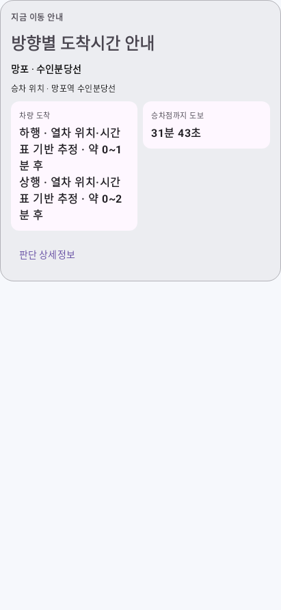

# 설치 APK 시간표 로딩 실패 원인과 운영 API·화면 검증

이전 검증은 소스 폴더의 압축 시간표를 직접 읽어, 설치 APK의 실제 파일명이 달라지는 문제를 놓쳤다. 이번에는 수정 전 APK로 실패를 재현하고, 수정 후 APK의 실제 리소스와 운영 API 응답으로 Android 안내 카드 표시·갱신을 검증했다.

## 확인한 원인

소스에는 `timetables/1075_WEEKDAY.json.gz`가 있다. Android 패키징 도구 AAPT는 이 파일을 풀어 APK에 **`assets/timetables/1075_WEEKDAY.json`**으로 넣는다. 앱의 시간표 로더는 존재하지 않는 `.json.gz`만 열어 `FileNotFoundException`이 발생했다. MainActivity가 예외를 화면에서 보이지 않는 메시지로 처리해 `N번째 전역` 안내만 남았다. APK에 들어 있는 29개 노선·요일 시간표 모두 같은 문제였다.

수정 전 APK의 ZIP 항목만으로 리소스를 여는 회귀 검증은 실제로 다음 오류로 실패했다.

```text
java.io.FileNotFoundException:
AssetManager.open: timetables/1075_WEEKDAY.json.gz
```

수정 전 APK SHA-256: `1c2c2257639dd92e37ca9bcae5ea35ef0e8f2947f5c67112b4b9f96a76f7af83`.

## 수정

- `OfficialTimetableRepository`: APK의 일반 `.json`을 우선 읽는다. 파일 기반 도구처럼 압축 원본만 있는 환경은 `.json.gz`로 대체한다. 실제 시간표나 역간 시간은 바꾸지 않았다.
- `JourneyScreenState`, `MainActivity`: 시간표 로딩 오류를 별도 상태로 보여주고, 정상 추정이 생성됐는데도 `원본 0초라 판단 보류` 오류가 남는 것을 막는다. 방향별 ETA가 있으면 위치 전용 안내로 돌아가지 않는다.

공식 실시간 ETA가 양수이면 그 값이 우선이다. 0초일 때는 공식 열차 위치와 실제 시간표 정차 순서로 계산한 **시간표 기반 추정**을 표시한다. 초 단위 정확도를 만들지 않으며, 시간 범위와 출처를 구분한다.

## 실제 운영 API → Android 카드 표시 증거

운영 Worker를 앱과 같은 정상 요청 헤더로 직접 호출했다. 응답 파일을 미리 정해 놓은 재생 테스트가 아니라, Android UI 검증 실행 중 HTTPS로 새 응답을 받았다. 첫 조회와 두 번째 조회 사이에 실제 33.797초가 지났다.

| 항목 | 첫 조회 | 다음 조회 |
| --- | --- | --- |
| 한국 시각 | 2026-10-26 20:13:38.672 | 2026-10-26 20:14:12.469 |
| HTTP 상태 | 200 | 200 |
| 수신 열차 수 | 5 | 5 |
| 카드에서 확인한 상행 ETA | 약 0~2분 후 | 약 0~2분 후 |
| 카드에서 확인한 하행 ETA | 약 2~4분 후 | 약 0~1분 후 |

두 번 모두 **수정 후 실제 APK 안의 시간표**를 읽고, 생산 코드의 ETA 계산기와 `AutomaticGuidanceCard`를 실행했다. Android UI semantics로 분 단위 텍스트의 실제 표시를 확인했고, 다음 응답으로 화면 상태를 갱신한 뒤 다시 표시 여부를 확인했다. 추가로 동일 관측에 60초를 적용하는 카운트다운 검사도 통과했다. 이 추가 검사는 실제 두 번째 API 조회와 별개의 시계 입력 검사다.

검증 환경은 **Robolectric Android SDK 35의 실제 Compose 카드 실행**이다. 물리적 휴대폰 원격 조작이나 지도·GPS·백그라운드 서비스 전체 검증을 했다는 뜻은 아니다. 카드의 도보시간 31분 43초는 사용자 첨부 화면과 같은 표시 입력이며 이번 검증에서 새 GPS로 측정한 값이 아니다.

첫 실제 응답으로 그린 카드:


33.797초 후 두 번째 운영 응답으로 갱신한 카드:



요청 시각·응답 SHA-256·표시 문자열·검증 환경·APK 및 이미지 SHA-256은 [검증 메타데이터](proof/subway-eta-20261026/live-ui-proof.json)에 보관했다. 키·인증 헤더·개인 GPS 좌표는 포함하지 않는다.

## 추가 검증과 적용

- 수정 전 동일 APK 리소스 경로 검증 실패, 수정 후 성공.
- 실제 APK의 시간표 29개 노선·요일 그룹을 모두 정상 파싱.
- 1호선은 APK의 공식 시간표에 구성한 위치 관측으로 숫자 ETA 생성 확인. 실제 1호선 HTTP 조회와 구분한다.
- `:app:compileDebugKotlin`, `:app:assembleDebug` 성공. 기존 회귀 검증 90개 통과, 실패·오류 0개. 최종 APK의 SHA-256이 Android 카드 검증에 사용한 APK와 일치함도 확인했다.
- 테스트 소스·추가 테스트 의존성은 저장소에 넣지 않았다.

기존 APK를 계속 실행하면 기존 로더가 남는다. 수정된 main으로 APK를 다시 빌드·설치해야 한다. Worker 소스·키는 변경하지 않았으며 이번 수정에 따른 Worker 재배포는 필요 없다.
