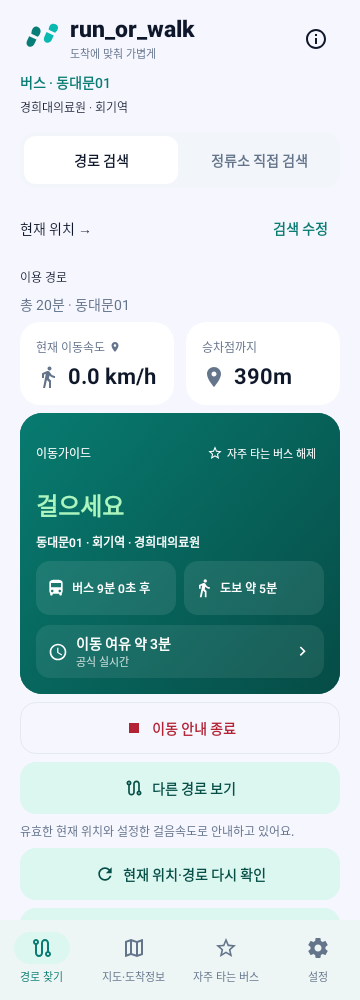
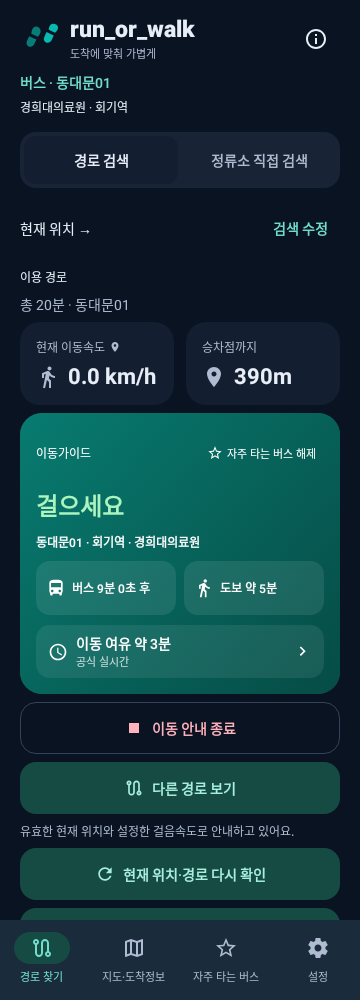
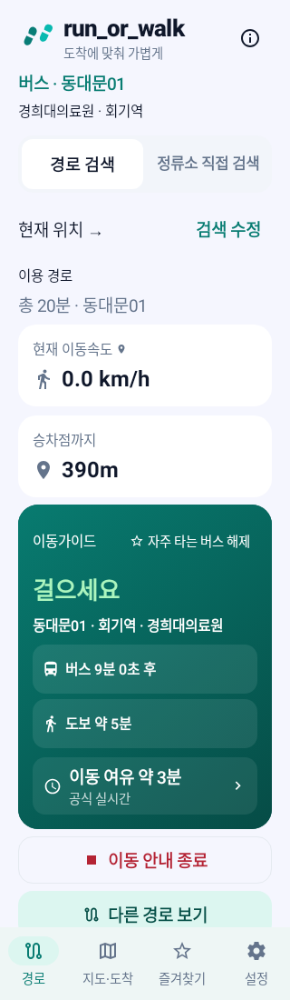
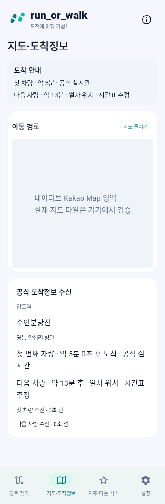
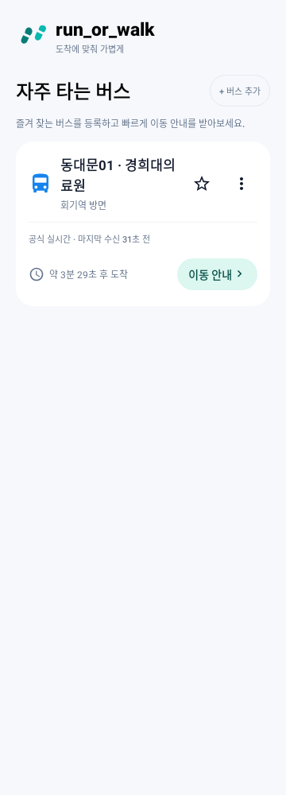

# 최종 안내 안정성 후속 개선 — 2026-10-28

- 기준: `081443a70c03cba8db9dd0b8f839be0660ec8861`
- 작업 브랜치: `fix/final-guidance-stability-followup-20261028`
- 검증한 소스 커밋: `e009a1c8ee820d7cf45ea443dc9371ef9e1b197b`. 이후 보고서·이미지만 추가하며 최종 결과 커밋 SHA는 완료 답변에 기재한다.
- 범위: Android 안내 전환·즐겨찾기 조회·지도 표시 안정화. main 병합 및 운영 Worker 배포 없음.

```bash
git log -1 --format='%H %s' -- app/src/main/java
```

## 확인된 원인과 수정

| 항목 | 확인 근거 | 수정 |
|---|---|---|
| 새 안내를 요청하자마자 기존 작업 취소 | `JourneyMonitoringService.onStartCommand`가 새 ETA/GPS 준비 전에 `stopLocationTracking`과 `monitoringJob.cancel` 실행. 수정 전 Service 재현 테스트 실패 | 기존 세션을 유지하며 후보 데이터 준비 → 공식 식별자·위치·도보·ETA 재검증 → 활성 세션 교체 |
| 서비스 시작 요청 접수를 전환 성공으로 처리 | Controller의 Boolean은 Intent 접수 결과였고 UI는 즉시 즐겨찾기를 열었음 | 토큰별 완료 응답을 기다리는 `startAndAwait`. 서비스가 실제 활성화한 뒤에만 UI 전환 성공 처리 |
| 느린 즐겨찾기가 다른 정류소까지 차단 | Loader의 단일 Mutex 안에서 네트워크 실행. 수정 전 다른 정류소가 500ms 안에 완료하지 못해 테스트 실패 | 공식 선택별 잠금과 최대 2개 동시 작업. 동일 키 요청 합치기 및 정류소별 메타데이터 공유 |
| Loader만 고쳐도 실제 서울 요청은 직렬 | 서울 Repository 내부에도 전체 요청을 감싼 단일 Mutex 확인 | 실제 Repository도 요청 키별 잠금·동시 2개로 수정. 기존 30초 캐시와 백오프 유지. 합성 transport로 실제 Repository 경로 검증 |
| 갱신 결과의 표시가 다음 1초 틱까지 지연 | Compose에서 캐시가 있으면 Elvis 연산 뒤의 `result` 상태를 읽지 않아 완료를 구독하지 않는 경로 | 완료 상태를 항상 읽고, 같은 Compose scope에서 현재 시각으로 유효성 재검증 |
| 파란 지도 접근 경로가 갱신 전에 사라질 수 있음 | `!fresh`에서 기존 segments를 비우던 코드 확인. 실제 Kakao 타일 깜박임은 실기기 미검증 | 같은 선택의 마지막 경로는 참고 표시로 유지. 새 좌표 준비 후 교체. 도보 계산용 수명은 연장하지 않음 |
| 유효한 백그라운드 GPS와 이전 화면 위치 오류가 동시 노출 | 기존 실제 Compose 테스트가 이 조합을 구성했고 렌더링에서도 확인 | 유효 위치·정상 판단이 있는 경우 그 이전 화면의 일반 위치 오류만 현재 안내 근거 설명으로 교체. 권한 오류·실제 GPS 오류 및 설정 버튼 유지 |

초기 실패 테스트 2개는 `GuidanceFollowupReproductionTest`에 그대로 남아 있다. 나머지 변경은 코드 경로 분석과 수정 후 회귀 테스트로 검증했으며, 모든 변경을 수정 전 실기기에서 재현했다고 주장하지 않는다.

## 안내 전환의 처리 순서

1. 사용자 확인 후 토큰을 발급한다. 서비스 Intent가 접수됐다는 이유로 전환을 확정하지 않는다.
2. 이전 위치 추적·ETA 조회·도보 경로·알림 세션은 계속 동작한다.
3. 후보의 원래 시각이 유효한 화면 데이터를 재사용하거나 필요한 GPS·공식 ETA·실제 도보 경로를 준비한다. 이전 정류장의 ETA를 후보에 복사하지 않는다.
4. 후보 request 및 공식 제공기관·정류소·노선·방향, 위치 정확도/시각, 경로 및 기존 계산기의 판단 가능 여부를 다시 검사한다.
5. 후보가 유효할 때만 기존 작업을 취소하고 새 세션을 활성화한 뒤 성공을 응답한다.
6. 후보 준비 제한은 40초, UI의 서비스 응답 대기는 50초다. 실패·시간 초과·더 최신 요청·선택 변경·대기 중 화면 작업 취소는 이전 세션을 유지한다.
7. 사용자의 명시적인 종료와 서비스 파괴는 후보 작업까지 취소한다. 취소를 무시하고 돌아온 과거 결과도 revision/token 검사로 차단한다.

위치/알림 권한이 실제로 철회된 경우에는 기존 안내의 동작 가능성도 떨어진다. 새 요청은 거절하며 기존 모니터가 기존 권한 정책에 따라 종료·오류 안내한다. 권한 없는 안내가 계속 정상 동작한다고 표시하지 않는다. 프로세스 자체가 종료된 경우의 세션 복원은 이번 변경의 대상이 아니다.

새 노선 검색 중 화면은 선택 미리보기이고 기존 서비스는 별도 실행 중임을 표시한다. 즐겨찾기의 새 안내는 서비스 활성화 확인 후 연다. 선택 식별자와 모니터링 식별자가 다르면 해당 데이터를 혼합하지 않는다.

## ETA·도보·판단 연속성

기준 커밋에서 이미 구현된 부분 병합·독립 만료·도보 유지·시각 계산을 유지했다. 로딩 여부가 표시 데이터의 유효성을 대신하지 않는다.

| 상황 | 결과 |
|---|---|
| 정상 ETA 재조회 중/응답 지연 | 기존 절대 도착시각 기준 카운트다운과 판단 유지 |
| 도보 경로 약 30초 재계산 | 기존 유효 거리·시간 유지 후 유효한 결과로 교체 |
| 첫 차량 또는 다음 차량만 갱신 | 해당 차량만 교체. 다른 차량의 원래 시각 유지 |
| 일시적 API 실패 | 유효기간 안의 관측만 유지. 실패 상태는 별도 표시 |
| 차량 통과·개별 ETA 만료 | 해당 관측 제거, 남은 유효 차량 재선택 |
| 성공한 빈 공식 응답/운행 종료 | 기존 정상 병합 정책에 따라 이전 관측 제거 |
| 정류소·노선·방향 변경 | 이전 선택 데이터 폐기, 새 데이터와 혼합 금지 |
| GPS 부정확/위치·도보 만료 | 기존 계산기의 UNKNOWN 정책 유지. 수명을 연장하지 않음 |

속도 미측정은 내부적으로 `null`, 화면에는 `0.0 km/h`다. 유효 측정 0과 구분한다. 미측정 시 기본 설정 속도로 도보시간을 계산하며, 이를 GPS로 측정한 속도라고 표시하지 않는다. 위치 정확도·평활화·정지 시 경로 진행도 정책은 유지했다.

### 실제 Compose 갱신 비교

다음 PNG는 수정된 실제 Compose 컴포넌트를 Robolectric에서 **모의 데이터로 렌더링**한 것이다. 실기기나 운영 데이터 캡처가 아니다.

| 갱신 전 | ETA·도보 갱신 대기 중 | 새 유효 ETA·도보 적용 후 |
|---|---|---|
|  |  |  |

테스트 시나리오: ETA 5분/도보 180초/234m → 30초 경과 후 요청 대기 중 ETA 4분 30초/도보·거리 유지 → 새 ETA 약 3분 및 새 도보 165초/220m. UI와 서비스 공통 계산기의 결과를 각 단계에서 대조한다. 카드 semantics ID도 유지한다. 기존 다음 차량·오류 유지·만료·역순 응답 회귀 테스트를 함께 실행했다.

## 즐겨찾기 조회와 실패 정책

### 호출 구조

- 카운트다운: 화면에 구성된 카드만 1초 표시 갱신. 이 작업은 네트워크를 호출하지 않는다.
- API: 조회 예정 시각까지 coroutine이 대기한다. 예전처럼 매초 Loader를 호출하지 않는다.
- 동일 공식 선택: 진행 중 요청 합치기, 정상 최소 30초 간격.
- 다른 선택: Loader 및 실제 서울 Repository 각각 동시 최대 2개. 진행 대기 뒤에도 제공기관 제한 재확인.
- 같은 정류소의 공식 노선 메타데이터, 경기 도착 응답: 30초 공유 캐시. 원본 수신시각은 갱신하지 않는다.
- 비활성 화면·탭 제거: 카드 작업 취소. 재진입 시 ViewModel의 캐시·마지막 조회시각·서버 제한을 확인한다.
- Loader 요청 제한 20초와 기존 Repository 연결/읽기 제한을 함께 적용한다. 차단 소켓 I/O의 실제 취소 시점은 기존 네트워크 타임아웃에도 영향을 받는다.

### 실패 유형별 적용 정책

| 실패 유형 | 처리 |
|---|---|
| 일시적 네트워크/서버 오류 | 선택별 30→60→120→240→300초. 이후에도 300초 간격으로 자동 재시도하며 영구 중단하지 않음 |
| 타임아웃 | 별도 TIMEOUT 분류, 동일한 제한적 백오프, 다음 허용 시각 자동 복구 |
| 429/제공기관 호출 제한 | 제공기관 전체 제한 공유. 로컬 백오프와 서버 Retry-After 중 더 늦은 시각 준수 |
| 명시적인 서버 재시도 시각 | 다른 카드·대기 중 요청·수동 조회도 동일 제한 준수 |
| 인증·API 설정 오류 | CONFIGURATION 안내, 최소 300초/서버 제한 유지. 무한 주기 재시도를 보류하고 화면 재진입 또는 수동 새로고침에서 허용 시각 이후 한 번 재확인 |
| 공식 정류소·노선·승차 순서 불일치 | INVALID_SELECTION으로 구분, 이전 ETA 제거·다시 선택 안내. 자동 반복 보류, 화면 재진입/수동에서 재확인 가능 |

**정책 선택:** 연속 실패 후 모든 자동 조회를 중단하는 방식은 적용하지 않았다. 일시적 통신 장애는 종전 최대 300초 자동 재시도를 유지한다. 이번 요청서의 인증·설정 오류는 별도로 구분해 무한 자동 반복하지 않는다. 수동 버튼·탭 재진입도 최소 간격이나 서버 시각을 우회하지 못한다.

실패 5회 이상이면 `연결 상태 확인 필요 · 자동으로 다시 조회해요`를 안내한다. 네트워크가 복구되면 다음 허용 시각에 자동 복구한다. 실제 ConnectivityManager 복구 이벤트로 제한을 강제 초기화하지 않는다. 기존 모의 장시간 장애 시나리오(13회 실패 후 52분 30초 복구)도 통과했다.

### 많은 즐겨찾기 검증

합성 공식 선택 12개와 각 키의 중복 요청 12개를 동시에 실행했다. 실제 처리 12개, 중복 네트워크 요청 0개, 최대 동시 처리 2개였다. 이후 60회의 캐시/예정시각 표시 확인으로 추가 API 호출이 발생하지 않았다. 느린 다른 정류소가 완료되기 전에 정상 정류소가 완료되고, 실제 서울 Repository에서도 동일 키 캐시와 다른 키의 독립성을 확인했다.

실제 LazyColumn 스크롤 프레임 시간·12개 실제 정류소의 운영 호출량·장시간 배터리 소비는 미측정이다. 정상 자동 조회를 영구 중단하지 않으므로 오랫동안 화면을 사용하면 총 호출은 누적된다. Worker가 제한하면 서버 시각을 준수한다.

### ETA가 없는 즐겨찾기

공식 승차정보와 ETA를 구분한다. 공식 정보만 유효한 경우 `도착정보 없이 열기`로 표시하고, ETA가 있어야 이동 판단을 시작한다고 안내한다. 미리보기는 열 수 있지만 ETA 없는 정상 실시간 판단을 생성하지 않는다. 기존 서비스를 교체하는 경우에는 새 필수 데이터 준비 실패 시 기존 안내를 유지한다. 별칭·공식 ID·위아래 순서 변경·삭제 확인·로컬 복원은 유지한다.

## 지도와 작은 화면

- 지도·도착정보 탭에서 첫/다음 ETA 요약을 지도 위에 배치했다. 아래 상세에는 각 차량의 ETA 출처와 마지막 수신시각을 표시한다.
- 기본 펼침·줄이기/펼치기·현재 위치·확대/축소·마커·색상은 유지한다. 펼침 높이는 화면 높이 약 36%, 220~360dp로 조정하고 축소는 112dp다.
- 파란색 GPS→지정 출발지 / 초록색 지정 출발지→목적지 경로 유지. 현재 위치와 출발지가 같은 경우 중복 선을 만들지 않는 기존 처리 유지.
- 같은 선택의 접근 경로는 120초 계산 수명이 끝나도 잠시 참고로 표시하며 `이전 경로 · 갱신 필요` 상태를 분리한다. 마지막 성공으로부터 최대 300초, 원래 위치에서 100m 초과 이탈 시에는 참고 선도 제거한다. 출발지 변경 시 기존 선택의 선은 즉시 제거한다.
- 참고 선은 실제 도보시간·거리·이동 판단의 새 근거로 재사용하지 않는다. 경로 API 재조회 중 원래 도보 유효기간을 갱신하지 않는다.
- Kakao 선 교체는 동일 좌표면 재생성을 건너뛰고 새 선 추가 후 이전 선을 제거한다. 네이티브 지도의 프레임 단위 깜박임 개선 정도는 실기기 확인 필요다.

| 라이트 360dp | 다크 360dp | 320dp·글자 130% |
|---|---|---|
|  |  |  |

| 지도·도착정보 | 즐겨찾기 갱신 중 | 즐겨찾기 응답 후 |
|---|---|---|
|  |  |  |

지도 이미지는 실제 Compose 지도 프레임·요약·상세의 모의 렌더다. 회색 네이티브 지도 영역은 테스트 대체 영역이며 Kakao 지도 타일의 검증 증거가 아니다. 지도 경로 전/중/후의 실기기 캡처는 미제출이며, 대신 좌표 유지·만료를 상태 테스트로 확인했다. 기준 커밋의 이전 화면은 [이전 보고서](FINAL_UX_RELIABILITY_20261028.md)의 이미지와 비교할 수 있다.

## 수정 파일

| 파일 | 핵심 변경 |
|---|---|
| `JourneyMonitoringController.kt` | 전환 토큰·완료 대기·실패/취소 응답, 접수와 활성화 구분 |
| `JourneyMonitoringService.kt` | 후보 준비 후 전환, 기존 작업 보호, 마지막 시점 재검증·자원 정리. 운영과 테스트가 같은 준비 경계를 사용 |
| `MainActivity.kt` | 서비스 승인 후 UI 적용, 화면 선택 변경 guard, 지도 참고 선 유지·상단 ETA 요약·유효 위치 안내 |
| `FavoriteBuses.kt` | 선택별 중복 병합·동시 2개·공유 캐시·예약시각·타임아웃/설정/선택 오류 분류 |
| `SeoulBusRepository.kt` | 실제 요청 키별 잠금·동시 2개, 스레드 안전한 최대 Retry-After 보존 |
| `DashboardScreen.kt` | API 예약 대기와 표시 틱 분리, Compose 완료 상태 구독, ETA 없는 즐겨찾기의 명시적 미리보기 |
| `JourneyScreenState.kt` | 지도 참고 상태·최대 표시 수명·이탈 조건. 계산 데이터와 분리 |
| `MapArrivalOverview.kt` | 지도 위 ETA 요약, 각 차량의 출처/수신시각 |
| `kakaomapkanel.kt` | 동일 선 재생성 방지, 새 선 추가 후 이전 선 제거 |
| `gradlew` | 실행 권한 추가. 요청한 `./gradlew` 명령을 Linux에서도 그대로 실행 가능 |
| 테스트·proof·본 문서 | 수정 전 재현 2개, 후속 정책·Service·Repository 회귀, 외부 회귀 이관, 실제 Compose 모의 이미지 |

## 유지한 핵심 정책

이동 여유 = 유효한 차량 ETA − 도보시간 − 승차 준비 여유. 기존 5단계 경계(4분/2분/0초/−90초)와 실제 탑승 가능한 다음 차량만 권하는 정책을 바꾸지 않았다. 전역 진동 30초, 최초 무진동·중복 방지·전환 안정화 정책도 유지했다.

GPS 약 4초, 도보 계산 약 30초, 원래 GPS 30초/도보 120초/공식 ETA 최대 600초·수신 최대 60초 및 더 짧은 개별 만료를 바꾸지 않았다. 서울·경기 버스, 지하철 공식 위치·시간표 ETA, 경로 검색 및 저장 복원은 기존 계산기를 사용한다.

Worker 소스·Durable Object·캐시·원본 900회/24시간 예산·IP 제한·API 키는 변경하지 않았다. Worker 변경이 없어 이번에는 Worker 빌드/배포를 실행하지 않았다. 새 APK 설치는 필요하고 Worker 재배포는 필요하지 않다.

## 테스트 재현성과 결과

요청된 명령을 실행했다. 클라우드 SDK/JDK 경로 활성화 이외에 일회성 테스트 sourceSet을 추가하지 않고 저장소만으로 다음 명령을 실행할 수 있다.

```bash
./gradlew :app:compileDebugKotlin :app:testDebugUnitTest :app:assembleDebug
```

- 저장소 테스트 **246개 통과 / 실패 0 / 오류 0 / 건너뜀 0**. Kotlin 컴파일·APK assemble 성공.
- 기존 저장소 142개 + 이관한 기존 외부 84개 + 이번 후속 테스트 20개 = 246개다.
- 이전 보고서의 외부 107개 중 12개 파일/84개 테스트를 정식 이관하고 고정 `/workspace` 경로를 제거했다. 공식 시간표·열차 위치·선택 보존·다음 차량·속도·지도 경로 회귀를 포함한다.
- 남은 4개 파일/23개는 외부 보관 운영 응답에 의존한다. 실제 운영 데이터를 새로 커밋하지 말라는 조건을 지키기 위해 데이터를 복사하지 않았다. 해당 **23개도 별도로 재실행하여 전부 통과**했다. 이 실행은 운영 API 신규 호출이 아닌 보관 응답 재생이다.
- 따라서 246개는 다른 개발자가 저장소에서 재현 가능하며, 추가 23개는 외부 원문 없이는 재현 불가다. 이 둘을 합쳐 저장소 테스트 수라고 표기하지 않는다. 실패한 기존 테스트를 삭제하지 않았다.
- 수정 전 재현: 2개 실행, 2개 실패. 수정 후 같은 테스트 모두 통과.
- 후속 검증: 실제 Service 후보 전환, 첫 ETA 실패, GPS 실패, 권한 부족, 시간 초과, 방향/식별자 불일치, 종료·늦은 결과·새 선택 보호, Repository 병렬성, 제공기관 최대 제한 시각, 참고 선 유지/무효화.
- 기존 Compose 갱신 전/중/후·독립 차량 만료·30초 도보 교체·화면/서비스 판단 일치·화면 비활성 조회 중지/복귀·30초 전역 진동·0.0 속도 표시·작은 화면 회귀를 통과했다.

인증 설정 보류와 동시 처리 수를 의도적으로 바꾼 정책 테스트는 새 요구에 맞게 갱신했다. 실제 UI 검증에서 위치 설정 버튼이 사라지는 회귀를 발견하여 버튼을 복원했다. 검증을 약화시켜 통과시키지 않았다. 추가 Repository 합성 응답의 필수 fetchedAt 누락도 응답 fixture를 올바르게 수정했으며 파서 검증을 완화하지 않았다.

세부 결과와 APK SHA-256: [validation.json](proof/final-guidance-followup-20261028/validation.json).
APK 경로: `app/build/outputs/apk/debug/app-debug.apk` (APK·local.properties·운영 원문은 커밋하지 않음).

## 미검증 및 실기기 확인 목록

| 항목 | 상태 |
|---|---|
| 최신 운영 API·실제 버스/지하철 운행 | 이번 작업에서 신규 실시간 호출 미실시. 기존 보관 응답 재생과 모의 검증만 실시 |
| Kakao 타일·폴리라인 깜박임·지도 제스처·메모리 | 실제 휴대폰 미검증. 모의 PNG의 회색 지도 영역으로 대체 검증했다고 주장하지 않음 |
| 실제 GPS 이동·실내 복구·센서 정확도 | 기기 이동 테스트 미실시 |
| 화면 꺼짐/절전·OS 서비스 시작 제한 | Robolectric Service 수명·실패·취소 검증. 실제 OS/제조사 절전은 미검증 |
| 실제 진동·TalkBack 읽기 순서 | 계산·호출·접근성 semantics 회귀 통과. 물리 진동·TalkBack 음성 미검증 |
| 10개 이상 즐겨찾기 장시간 사용 | 합성 요청 수/동시성·화면 생명주기 검증. 실제 스크롤 프레임/배터리/운영 호출량 미측정 |
| 프로세스 종료 후 서비스 복원 | 자동 재시작 정책을 추가하지 않음. 저장된 공식 선택은 기존 복원 기능 사용 |

실기기에서는 같은 경로의 ETA 갱신 전/중/후, 새로운 노선 전환 실패 시 기존 알림 유지, 지도 파란 선 재조회, 화면 꺼짐 상태 알림·진동을 우선 확인해야 한다.
