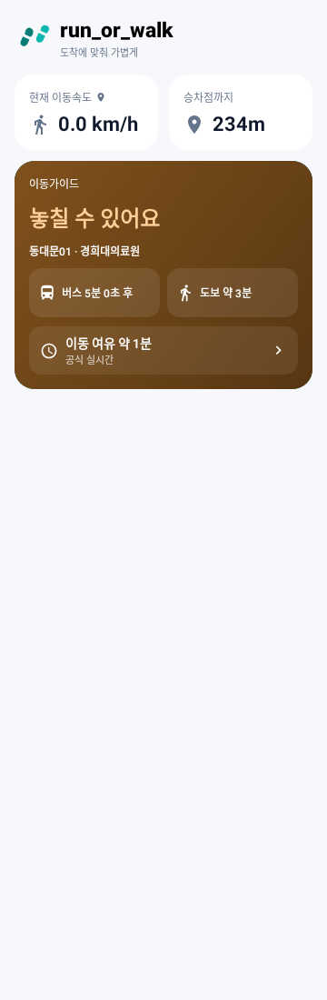
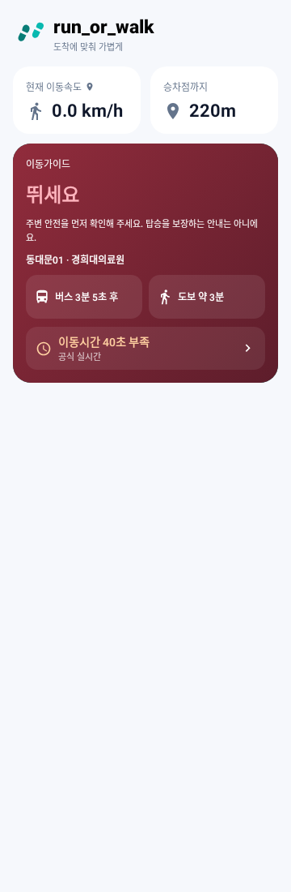

# Run_or_Walk 최종 안정화·이동 안내 연속성 검증

2026-10-28 (KST). 기준 `89d9dedadff6f07a344c545687bdae1d06d5328b`, 작업 브랜치 `fix/final-ux-reliability-20261028`.

시작 시 원격 feature 브랜치가 정확히 기준 커밋인 것을 확인했다. 후속 수정 커밋은 없었다. 이 커밋에서 새 작업 브랜치를 생성했으며, main은 변경하지 않았다. 아래의 ‘재현’은 소스 조건·단위/Compose 모의 재현을 의미하며 휴대폰에서 관측했다는 뜻이 아니다.

## 1. 문제별 처리 결과

| 항목 | 기존 문제 확인 | 처리 결과 | 검증 및 한계 |
| --- | --- | --- | --- |
| 즐겨찾기 ETA | 최초 `load` 이후 표시 시각만 갱신. 실패 시 이전 snapshot 손실 | 재현 후 수정 완료 | 수정 전 실패 테스트, 자동 30초 재조회, 갱신 대기 중 유지, 독립 차량 병합/만료, 화면 이탈/복귀, 긴 장애 후 복구 검증 |
| 지도 API 호출 | 지도 비활성 조건 없음. GPS를 LaunchedEffect 키로 사용. 실패 시 좌표를 비워 다음 GPS마다 재조회 가능 | 재현 후 수정 완료 | 지도 전용 효과를 활성 탭/RESUMED로 한정. 단일 진행 요청·30초 최소 간격·실패 백오프 정책 검증. 실제 휴대폰 HTTP 계측은 미실시 |
| 이동 안내 자동 종료 | 검색 편집·장소/경로/즐겨찾기 선택에서 `stop`. 시작 실패도 전체 상태를 failure로 대체 | 재현 후 수정 완료 | 수정 전 실패 테스트, 실제 루트 검색 편집/즐겨찾기 변경 취소/연결 실패 시 기존 안내 유지, 유효한 새 요청 staging 검증 |
| ETA 출처 혼동 | 첫 차량 실시간+다음 차량 시간표인데 공통 실시간 출처 표시 가능 | 재현 후 수정 완료 | 각 행의 출처·정밀도·수신시각 분리. 혼합/동일 출처, 누락·만료·방향 불일치 검증 |
| 하단 탭 이동 | BackHandler가 `tab>=2`여서 지도 탭 제외 | 재현 후 수정 완료 | 지도/설정/즐겨찾기→경로, 정보창 진입·종료 회귀. 기존 걷기 분석 진입/복귀 회귀 유지 |
| 지도 사용성·생명주기 | 숨겨진 지도도 Activity RESUMED 상태 유지. 축소 지도에서 조작 버튼 겹칠 위험 | 코드상 위험 확인, 실기기 검증 필요 | 같은 MapView 유지·숨김 시 pause/복귀 resume, 전용 탭 지도 높이 확대, 축소 시 작은 미리보기/조작부 감춤. 타일·메모리·터치 실측은 미실시 |
| 속도 표시 | 표시용 0.0과 실제 0.0의 구별이 없음 | 재현 후 수정 완료 | 숫자는 그대로 유지하고 GPS 수신 상태 아이콘/접근성 설명 추가. 실제 정지와 미측정의 설명 차이, 320dp·130% 한 줄 단위 검증. 속도 계산 정책 불변 |
| 다음 차량 안내 | 유효한 다음 차량만 추천하는 기존 계산은 정상 | 기존 코드가 정상이라 계산 변경 불필요 | 현재 차량 ‘탑승 어려움’과 다음 차량 조회/추천 계층만 보완. 실제 다음 ETA 없으면 생성하지 않음 |
| 상태 메시지·연속성 | 즐겨찾기의 응답 시각이 이전 화면 틱보다 새로워 일시 제외될 수 있음. 잘못된 새 도보 응답이 유효한 이전 경로까지 삭제 | 재현 후 수정 완료 | 새 응답을 읽는 Compose 재시작 범위 안에서 현재 시각 재평가. 틱 사이 응답 테스트 및 도보 실패 시 이전 근거 보존. 실제 만료/이탈/선택 변경은 여전히 제외 |
| 접근성 | 안내 카드 전체가 live region이라 ETA/여유시간 감소도 알림 대상 | 코드상 위험 확인, 실기기 검증 필요 | 중요 제목만 live region. 1초 ETA 변경 시 전체 카드 알림 속성 없음/제목 1개만 유지하는 semantics 검증. 실제 TalkBack 발화는 미실시 |
| 즐겨찾기 관리 | 위로 이동만 있고 별 아이콘 선택 즉시 삭제 | 재현 후 수정 완료 | 아래로 이동·순서 영구 복원·삭제 확인/유지 동작 검증. 드래그 기능 추가 없음 |

‘지도 생명주기 정상’, ‘실시간 차량 도착 정확도 정상’, ‘휴대폰 진동 체감 정상’으로 단정하지 않았다. 아래에 실기기 체크리스트를 별도로 제공한다.

## 2. 최우선: 실시간 이동 안내의 연속성

### 유지·교체·무효화 기준

- ETA/도보 요청을 시작하는 로딩 플래그와 표시 자료를 분리한다. 유효한 기존 자료는 null로 초기화하지 않는다.
- ETA는 원래 절대 도착시각에서 현재 시각을 차감한다. 새 API 응답 전에도 카운트다운하며, 같은 캐시의 수신시각/유효기간을 새 관측처럼 늘리지 않는다.
- 도보 거리·시간은 기존 30초 계산값을 유지한다. 검증된 새 계산/경로가 준비되면 교체한다. 정지 중 시각만으로 거리를 줄이지 않는다.
- 거절된 새 도보 응답은 독립적으로 유효한 이전 경로를 삭제하지 않는다. 실제 경로 이탈·이전 자료 만료 등 그 근거 자체가 무효이면 보존하지 않는다.
- 새 자료는 공식 정류소·노선·방향·선택 ID, 원본 신뢰성·시각·유효기간을 확인한다. 다른 선택의 ETA/도보값을 혼합하지 않는다.
- 기존 요청 번호/선택 revision, 서비스 generation, 같은 여정 검사와 일부 차량 갱신 병합을 유지한다. 취소한 안내 변경의 늦은 응답도 새 서비스를 시작하지 못한다.
- 차량 통과·ETA 만료·선택 변경·GPS/경로 만료·권한 상실·실제 이탈·공식 자료의 반증은 안전한 무효화 사유다. 연속성을 이유로 오래된 자료를 최신처럼 유지하지 않는다.

기존 GPS 30초/도보 경로 120초/공식 ETA 원본 최대 600초·수신 최대 60초 및 더 짧은 개별 만료는 바꾸지 않았다. 갱신 간격과 유효기간은 별개다. 첫/다음 차량의 원래 만료는 독립적이다.

### Compose 세 화면 및 독립 갱신 검증

실제 `JourneyScreenState`의 공식 응답 병합·선택기, 공통 `calculateMovementGuidance`, 실제 Compose 카드·거리 컴포넌트에 모의 공식 자료를 넣었다. 설정 준비시간은 60초이며 기존 판단식을 그대로 사용했다.

| 단계 | 첫 ETA | 도보 | 거리 | 판단 |
| --- | --- | --- | --- | --- |
| 갱신 전 | 5분 0초 | 180초(화면 약 3분) | 234m | 놓칠 수 있어요 |
| 30초 후 ETA·도보 조회 대기 | 4분 30초 | 이전 180초 유지 | 234m 유지 | 놓칠 수 있어요 유지 |
| ETA 먼저 수신 | 새 공식 ETA 3분 5초 | 이전 180초 유지 | 234m 유지 | 뛰세요 |
| 도보 결과 나중에 수신 | 같은 새 ETA 유지 | 새 165초(화면 약 3분) | 새 220m | 뛰세요 |
| 추가 15초, API 오류 | 2분 50초 | 165초 유지 | 220m 유지 | 뛰세요 유지 |
| 차량별 유효기간 모두 만료 | 이전 ETA 제거 | 원래 유효한 도보 근거만 유지 | 220m | 판단 보류/조회 실패 안내 |

전/중/후 카드의 semantics ID도 같음을 확인했다. 정상 갱신 중 카드가 다른 인스턴스로 교체되거나 `정보 확인 중`이 나타나지 않는다. 각 단계의 전면 계산과 `monitoringStateWithSettings` 결과도 일치했다. API 오류 자체가 UNKNOWN을 만들지 않으며, 자료가 실제로 만료되면 보류한다.

| 갱신 전 | 갱신 중 | 새 결과 적용 후 |
| --- | --- | --- |
|  |  |  |

이는 **실제 Compose 코드+모의 데이터 렌더**로 휴대폰 캡처가 아니다. 실제 도로 보행/차량 도착을 측정한 결과가 아니다.

## 3. 즐겨찾기 자동 재조회·실패·복구 정책

`FavoriteBusArrivalLoader`가 화면의 실제 재조회와 제공기관별 상태를 조정한다. ViewModel에서 같은 loader를 재사용하므로 탭/Activity 재구성으로 캐시·백오프를 즉시 잃지 않는다.

- 정상: 선택별 최소 30초 간격. 공식 노선 조회는 정류소별 공유하며 경기 도착 응답도 동일 정류소에서 30초간 공유한다. 기존 서울 Repository 캐시와 양쪽 Repository/Worker 백오프를 그대로 거친다.
- 동시성: loader Mutex로 직렬화하고 동일 선택의 중복 재조회를 병합한다. LazyColumn에 구성된 카드만 폴링하며 탭 이탈/화면 비활성 시 관련 코루틴을 취소한다.
- UI: 요청 중에는 기존 결과 유지, 별도 시계로 카운트다운. 새 응답을 소비하는 **동일 Compose 재시작 범위**에서 현재 시각을 읽어, 이전 1초 틱 때문에 새 자료가 미래 표본으로 잠깐 제외되지 않도록 했다.
- 일부 차량 응답: 기존 공통 병합 함수로 다른 유효 차량을 보존한다. 원래 source/receipt/deadline을 유지한다. 통과·명시적 종료·같은 슬롯 교체·빈 정상 응답은 기존 정책대로 반영한다.
- 일시적 네트워크/서버 오류: **30→60→120→240→300초**, 이후 최대 300초 간격으로 계속 자동 재시도한다. 영구 자동 중단은 없다. 실패가 누적되면 `연결 상태 확인 필요 · 자동으로 다시 조회해요`를 표시한다.
- 서버 `Retry-After`: 로컬 백오프와 서버 시각 중 더 늦은 시각을 사용한다. 서버가 하루를 요구하면 일반 5분 상한보다 서버 지시가 우선한다.
- 인증/연결 설정: 별도 `CONFIGURATION`으로 구분해 설정 확인 안내와 5분 간격의 안전한 재확인을 사용한다. Worker 설정이 고쳐지면 자동 복구할 수 있다. `RATE_LIMIT`, `TRANSIENT`와 구분한다.
- 사용자 새로고침: 동일 loader 경로를 사용한다. 설정된 백오프나 서버 대기 시각을 초기화/우회하지 않는다.
- 복구: 화면이 활성화되면 허용된 다음 시각에 자동 조회를 재개한다. 네트워크 복구 이벤트를 즉시 탐지하는 새 OS 감시 기능을 추가한 것은 아니다. 일반 장애는 최대 5분 이내의 다음 예약 시각에 재확인하고 서버가 더 긴 시각을 주면 그때까지 기다린다.
- 실패 중 유효한 ETA는 표시한다. 실제 만료 뒤에는 제거하고 오류/연결 상태를 안내한다. 새로운 성공이 오면 실패 누적 상태를 해제하고 정상 30초 간격으로 돌아간다.

**장시간 장애 테스트:** 모의 시계로 13번 연속 실패 후 52분 30초 시점에 연결을 복구했다. 수동 새로고침 없이 다음 허용 시각에 정상 ETA를 받았으며, 이후 정상 30초 조회로 복귀했다. 인증 거부 후 설정 복구 및 재시도 시각 직전의 중복/수동 호출 차단도 검증했다.

## 4. 나머지 변경 내역과 영향

| 파일 (`app/src/main/java/com/example/run_or_walk/`) | 원인·핵심 변경 | 기존 기능 영향/검증 |
| --- | --- | --- |
| `FavoriteBuses.kt` | 제공기관별 실패 분류·백오프, 정류소 공유 캐시, 실제 재조회, 부분 응답 병합, 아래로 이동 | 공식 ID·노선·방향 및 원래 만료 검증 유지. 별칭/순서 코덱 유지 |
| `DashboardScreen.kt` | 즐겨찾기 lifecycle 폴링·현재 응답 범위의 시계, 삭제 확인, 아래로 이동 메뉴, 지도 Back, 안내 변경 확인 | 기존 서비스 먼저 stop하지 않음. 변경 확정 시 공식 선택을 재확인하고 실패하면 기존 상태 유지 |
| `JourneySessionViewModel.kt` | 같은 즐겨찾기 loader 수명 유지 | 원본 GPS/ETA 영구 저장 추가 없음 |
| `JourneyMonitoringController.kt` | 시작 실패가 기존 실행 상태를 덮는 분기 수정, 별도 시작 오류, 새 여정 handover staging | 유효성·권한 검사 후 서비스가 인수하기 전까지 이전 여정 보존. 명시적 stop 유지 |
| `JourneyMonitoringService.kt` | 기존 FGS 교체에 최초 실행 절차를 반복하지 않음, staged handover 인수 | 기존 작업 취소/세대 검사·60분 종료·권한 회수 종료·종료 시 자원 해제 유지 |
| `MainActivity.kt` | 검색/미리보기의 자동 stop 제거, 새 안내 시작 확인, 지도 전용 조회 분리, 잘못된 새 도보 응답의 기존 경로 삭제 제거 | ETA·도보 주기/알고리즘 불변. 실제 선택 변경의 이전 자료 삭제 유지 |
| `WalkingAccessPolicy.kt` | 지도 전용 요청 gate: 활성 탭·단일 진행·30초 최소·실패 30/60/120/240/300초 | 기존 작은 GPS 변화 35m 재사용 조건 유지. 시각/ETA 갱신은 지도 조회 키에 없음 |
| `JourneyScreenState.kt` | 지도 요청 gate 수명 보관 | 원래 GPS/도보·차량 상태 유지 규칙 불변 |
| `MapArrivalOverview.kt` | 첫/다음 차량별 출처·정밀도·수신시각 선택/표시 | 표시 전용이며 혼합 출처를 판단 계산기로 새로 합성하지 않음. 임의 ETA 생성 없음 |
| `PaceNudgeComponents.kt` | 제목만 live region, GPS 상태 아이콘·설명, 좁은 화면 검색 탭 라벨 한 줄, 현재/다음 차량 계층·RUN 안전 설명 | 색상/문구 유지. RUN은 탑승 보장이 아니라는 보조 설명이며 판단 기준은 그대로 |
| `ArrivalRefreshRetention.kt` | 최초/위치/도보 만료/ETA 만료/방향 문제의 구체적 안내 | 정상 갱신이 판단을 초기화하는 조건으로 쓰이지 않음 |
| `kakaomapkanel.kt` | 기존 MapView 유지, 숨김 pause/복귀 resume, 축소 상태 조작부 정리 | 기존 마커·색상·확대·현재 위치·카메라/터치 중재 코드 유지. SDK 실동작은 별도 확인 필요 |

지도 전용 조회는 지도 탭 RESUMED에서만 실행한다. GPS 4초 수신/도보 30초 계산·서비스 ETA 조회는 별개여서 지도를 닫아도 계속한다. GPS 변경마다 네트워크 작업이 취소·재시작되지 않도록 최신 GPS를 읽는 루프와 요청 gate를 분리했다. 갱신 중 원래 유효한 좌표는 유지하고, 선택 변경/도보 좌표 120초 수명 등 무효 시에는 제거한다. 확장 지도는 화면 높이의 약 48%(280~440dp), 축소는 112dp 미리보기로 줄여 공식 도착정보 공간을 확보한다.

### 유지한 판단·진동·도보 정책

- 여유시간 = ETA − 도보시간 − 기존 준비시간. 원본 밀리초로 `>240 / >120 / >0 / >=-90 / <-90초` 다섯 구간을 그대로 사용한다.
- 유효한 다음 차량이 없으면 다음 ETA를 생성하지 않는다. 공식 실시간 우선·위치+공식 시간표·공식 시간표 예정의 검증도 바꾸지 않았다.
- 진동: ‘여유 있어요’ 무진동, 걸으세요 1회, 주의 2회, 뛰세요 3회, 다음 차량 2초 연속, 정보 부족 무진동.
- 실제 발생 후 전역 30초 제한, 최초/동일 상태 무진동, 변경 상태 3초 안정화, 차단 이벤트 비축 없음, UI 즉시 갱신을 유지했다.
- GPS/도보 계산 분리, 30초 계산 주기, 원래 유효기간, 정지 중 거리 감소 금지 유지.

## 5. 테스트·빌드 결과

수정 전 `FinalReliabilityReproductionTest` 두 테스트가 실패했다: 기존 안내를 지우는 시작 실패, 즐겨찾기 일시 실패 시 ETA 손실. 이후 새 응답 시각/Compose 재시작 범위 문제도 실제 UI 테스트로 확인·수정했다. 중간 실패 테스트를 통과로 계산하지 않았다.

최종 실행:

```bash
source /workspace/.cloud-setup/activate.sh
bash gradlew :app:compileDebugKotlin :app:testDebugUnitTest :app:assembleDebug \
  -PproofDir=/workspace/.cloud-setup/final-reliability-proof \
  --init-script /workspace/.cloud-setup/timetable-verification.gradle \
  --no-daemon --no-configuration-cache --max-workers=4 --console=plain
```

- **249개 통과, 실패/오류/건너뜀 0. BUILD SUCCESSFUL (1분 18초).** 저장소 테스트 142개 + 클라우드 기존 회귀/운영 캡처 재생 107개. init script를 빼면 저장소 테스트를 실행할 수 있다.
- 새 파일: `FinalReliabilityReproductionTest`, `FinalReliabilityPolicyTest`, `FinalReliabilityUiTest`. 기존 `GuidanceRefreshStabilityUiTest`, `GuidanceRevisionUiTest`, `DashboardUiTest`에 연속성/다크/320dp·130%/확인창/출처 기대값을 추가·수정했다.
- 자동 검증: ETA 전/중/후 카운트다운·부분 갱신·독립 만료·30초 도보 교체·오류 유지·선택 불일치·과거 응답 차단·전면/서비스 결과 일치, 길어진 장애 후 자동 복구, 수동·서버 백오프 준수, lifecycle 재조회 중지/재개, 변경 취소/실패·성공 staging, 삭제/정렬 영구 저장, 5단계/진동/자원 해제 회귀.
- Compose: 경로, 지도 프레임/도착정보, 즐겨찾기, 설정, 정보, 걷기 분석의 기존 회귀를 실행했다. 라이트/다크, 360dp, 320dp·130%, ETA 갱신/만료, GPS 부족, 다음 차량 미확인, 모의 실행 중 모니터링 상태 포함.
- Worker: `npm run check` 통과, `npm run build`의 **wrangler deploy --dry-run만** 통과, 기존 로컬 정규화/캐시/예산 상수 테스트 **6개 통과·실패 0**. 실제 Durable Object 동시성·예산 소진 실험은 미실시.
- Worker 소스·900회/24시간 예산·30초 캐시·API 키 설정 변경 및 운영 배포 없음.
- 이번에 새 운영 버스/지하철 GET을 하지 않았다. 클라우드 107개 중 이전에 실제 HTTP 200으로 수신한 서울/망포 응답은 **원래 수신시각에 재생**했다. 이를 현재 운영 API나 실제 스마트폰 검증으로 주장하지 않는다. M5107도 기존 모의/회귀 자료 검증이다.

[기계 판독 집계](proof/final-reliability-20261028/validation.json)

## 6. UI 이미지

모두 **실제 Compose 코드에 모의 자료를 넣은 Robolectric 렌더**다. 휴대폰 캡처가 아니다. 지도 이미지의 회색 영역은 네이티브 Kakao SDK를 실제 렌더하지 못해 표시한 **테스트 전용 자리 표시**이며 APK는 기존 실제 KakaoMapPanel을 사용한다.

- [라이트 경로](proof/final-reliability-20261028/final-route-light.png)
- [다크 경로](proof/final-reliability-20261028/final-route-dark.png)
- [320dp·글자 130%](proof/final-reliability-20261028/final-route-compact.png) — 이동가이드 확인을 위해 스크롤한 상태
- [보조 버튼](proof/final-reliability-20261028/final-route-actions.png)
- [지도·첫/다음 차량 혼합 출처](proof/final-reliability-20261028/final-map-arrivals.png)
- [즐겨찾기 새 응답](proof/final-reliability-20261028/final-favorites.png)
- [즐겨찾기 응답 대기 중 기존 ETA 유지](proof/final-reliability-20261028/final-favorites-refreshing.png)
- [앱 정보](proof/final-reliability-20261028/guidance-information.png)
- [기존 화면(개선 전)](proof/guide-controls-haptics-20261028/guide-controls-haptics.png)

## 7. API 호출량 변화

아래는 코드와 모의 호출 카운터로 확인한 범위이며 실제 스마트폰 패킷/배터리 계측값이 아니다.

- 지도 비활성: 지도 전용 추가 조회 0. 기존 실시간 ETA/이동 판단용 도보 요청은 계속한다.
- 정상 지도: 같은 좌표와 유효한 실제 경로는 재사용. 작은 GPS 변화만으로 재조회하지 않는다. 필요한 같은 지도 요청도 최소 30초 간격이며 실패하면 최대 5분 간격까지 늦춘다.
- 즐겨찾기: 잘못된 one-shot 조회를 필요한 자동 갱신으로 바꿨으므로, 오래 머무를 때 총 호출 수는 이전보다 증가할 수 있다. 정상 선택별 최소 30초, 동일 정류소 노선 조회/경기 응답 공유, 진행 요청 직렬화, 비활성 중지로 중복을 제한한다. 즐겨찾기 탭을 벗어난 뒤 계속 폴링하지 않는다.
- 통신 장애: 약 5분 간격의 낮은 빈도까지 줄이되 자동 복구 경로는 남긴다. 서버가 더 긴 대기를 요구하면 반드시 따르고 수동 메뉴로 우회하지 않는다.

## 8. 실기기 추가 확인 체크리스트

실기기 실행 환경을 확보하지 못했다. ADB 디바이스 열거도 이 환경의 프로필 쓰기 제약으로 실패해 연결 기기를 검증하지 못했다.

| 재현 방법 | 기대 결과/측정 |
| --- | --- |
| 지도↔경로 20회 전환, 축소/펼침, 앱 배경/복귀, Activity 재생성 | 타일 검게 됨/사라짐 없음. 마커·색상·현재 위치·확대/카메라 유지. 실제 터치와 스크롤 충돌 확인 |
| 같은 조작 전후 앱 메모리·배터리·패킷 측정 | MapView 중복 생성/누적 증가 없음. 숨김 렌더 pause 확인. 단위 테스트만으로 메모리 정상 단정 금지 |
| 실외 보행/정지/GPS 오차/권한 회수 | 미측정 0.0과 실제 정지 구분, 30초 계산 교체. 오래된 GPS나 실제 이탈이면 안전 보류 |
| 즐겨찾기에서 네트워크 끊기/10분 이상 유지/복구 | 유효기간 안 ETA만 유지, 이후 오류 안내, 허용 시각에 자동 복구. 화면 이탈 중 조회 없음 |
| 안내 중 다른 경로 검색/즐겨찾기 선택/변경 취소/새 연결 실패 | 기존 서비스 계속. 확정·공식 검증 후 교체. 새 시작 실패가 기존 안내를 지우지 않음 |
| 화면 꺼짐 15분, 상태 전환/종료 | FGS·알림 유지, 같은 판단, 종료 후 GPS/코루틴 해제. 60분 제한/OS 절전 영향 확인 |
| 실제 1/2/3회·2초 연속 진동, 10초 뒤 긴급도 상승 | 요청한 패턴과 전역 30초 차단, 최초/동일 상태 무진동 체감. 하드웨어 측정 미실시 |
| TalkBack 켜고 ETA 1초 감소와 상태 전환 비교 | 감소마다 전체 카드 반복 읽기 없음, 중요 판단 전환은 안내. 320/360dp·130% 실제 터치/글자 잘림 확인 |
| 실제 차량 도착·공식 시간표 추정 비교 | 추정 오차 측정 및 출처 구분. 이번 모의 검증을 정확도 실측으로 대체하지 않음 |

## 9. APK·브랜치·커밋

- APK 빌드 성공: `app/build/outputs/apk/debug/app-debug.apk`
- 크기: **58,771,151 bytes**
- SHA-256: `d233747470e603eab12ca3c75296aab062c61936fbe23d75e06ed0def02f1cdb`
- 새 APK 설치가 필요하며 Worker 재배포는 필요 없다. APK/로컬 키/실제 GPS·원본 개인정보를 Git에 추가하지 않는다.
- 브랜치: `fix/final-ux-reliability-20261028`
- 코드·테스트·이 보고서를 추가한 커밋의 SHA는 최종 응답과 원격 브랜치에서 제공한다. 저장소에서는 `git log -1 --format=%H -- docs/FINAL_UX_RELIABILITY_20261028.md`로 확인할 수 있다.

이 작업 브랜치에만 커밋·push한다. main 병합과 운영 Worker 배포는 하지 않는다.
