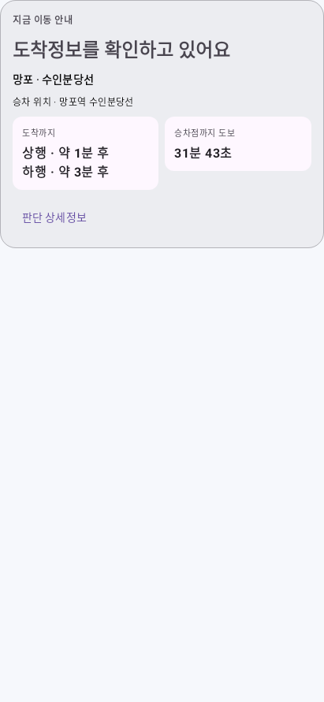

# 평균 도착시간과 공통 이동 안내

사용자 요청에 따라 도착 범위를 중간값 하나로 표시하고, 같은 도착시각을 화면·백그라운드의 도보 판단에 사용한다. 예를 들어 3~5분 범위는 `약 4분 후`로 표시하며, 비교 계산도 4분 기준이다. 일반적인 분 표시는 중간값을 가장 가까운 분으로 반올림한다. 공식 API가 직접 준 ETA는 기존처럼 우선 사용한다.

정류장 찾기와 경로 찾기는 같은 계산기·카드를 사용한다. 다음 차량과 이후 차량을 고르는 계산에도 각 범위의 중간값을 적용한다. 이미 중간 도착시각이 지난 후보는 다음 후보 선택에서 제외한다.

주요 안내는 다음 문구로 통일한다.

- `다음 차량을 기다리세요`: 기존 빠른 이동 기준으로도 첫 차량에 도달하기 어렵다.
- `뛰세요`: 평소 도보시간으로는 부족하지만 기존 빠른 이동 기준으로 가능하다.
- `걸으세요`: 도보시간과 설정한 여유시간을 충족한다.
- `여유 있어요`: 도보시간과 설정 여유시간을 빼고도 3분 이상 남는다.

도착까지 칸의 제목은 고정한다. 열차 위치·운행·시간표 상태에 따라 주요 제목이 바뀌거나 `시간표 기반 추정` 접두사가 붙지 않는다. 보행 설정 안내는 상세정보 안으로 옮겼다. 내부 원본 구간·출처·유효기간은 보존한다.

검증:

- Kotlin 컴파일·디버그 APK 빌드 성공, 임시 회귀 검증 94개 통과.
- 3~5분에서 표시·도보 판단 모두 4분을 쓰는 사례와 네 안내 상태, 다음 차량 중간값, 지난 중간값 제외를 검증했다.
- 운영 Worker를 실제 HTTPS로 두 번 조회하고 새 APK 시간표로 계산한 평균값이 Android Compose 카드에 표시·갱신됨을 검증했다. 화면에 범위 기호와 시간표 접두사가 없음을 확인했다.
- Android UI 검증에서 네 주요 문구가 실제로 표시되는 것도 확인했다. 검증은 Robolectric SDK35 실행이며 물리적 휴대폰 원격 조작과 구분한다.
- 추가 테스트 소스·의존성은 저장소에 넣지 않았다.

[조회 시각·표시값·환경 기록](proof/midpoint-guidance-20261026/proof.json)

적용에는 새 APK 빌드·설치가 필요하다. Worker 소스·키 변경과 재배포는 필요 없다.
