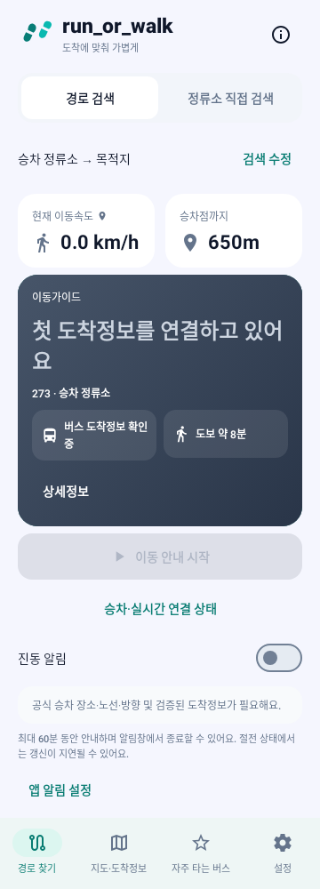

# 경로 찾기 GPS·도보 표시 연결 수정 — 2026-10-28

기준: `5630fd5caeb33610661cec520460b605f766b3db`

브랜치: `fix/route-location-walking-display-20261028`

## 확인한 원인

- 경로 찾기의 `JourneyMetrics`는 `personalizedWalk`에 거리 표시를 의존했다. 이 값은 공식 승차 ID에 연결된 `guidanceWalkingRoute`가 있어야 만들어졌다. **실제 GPS와 유효한 도보 경로·거리까지 있어도 공식 노선 연결이 아직 끝나지 않으면 승차점까지 확인 중으로 표시**될 수 있었다.
- 지도 위치는 rootScreen/currentPoint fallback을 사용했지만 경로 안내는 현재 screen.location만 참조하는 등 위치 선택 경로가 달랐다. 경로 선택 시 `clearWalking`은 위치도 지워 유효한 실제 GPS를 다시 기다릴 수 있었다.
- 최초 GPS 수신 직후 도보 조회가 필요한데도 다음 30초 조회 주기까지 기다리는 경로가 있었다.

수정 전 실제 Compose 재현 테스트 1개가 실패했다. GPS/도보 경로는 있고 공식 ID는 없는 상태에서 `650m`가 거리 카드에 나타나지 않았다.

## 수정

1. 검증된 실제 도보 경로의 거리·시간 표시를 공식 ETA/승차 ID 연결 상태와 분리했다. 공식 연결 전에도 원래 경로와 시각이 유효하면 수치를 표시한다.
2. ViewModel에 메모리 전용 최신 GPS 관측을 보관하고 지도와 경로 안내가 같은 최신 유효 위치를 선택한다. 원본 시각을 유지하며 30초가 지나거나 부정확·미래 시각인 관측은 사용하지 않는다. 이 위치는 저장 파일에 기록하지 않는다.
3. 새 경로/탭에서 유효한 GPS만 재사용한다. 이전 노선의 ETA나 이전 승차점의 도보 경로를 다른 선택에 복사하지 않는다.
4. 공식 연결 전에도 실제 경로의 보행 진행도를 반영하고 원래 도보 경로의 120초 수명을 유지한다. 정지 시 시간만으로 거리를 줄이지 않는 기존 tracker를 사용한다.
5. 첫 GPS를 받았고 도보 결과가 없으면 도보 조회를 바로 시도한다. 진행 중 요청 중복 방지와 기존 30초 외부 도보 API 호출 간격은 유지한다.
6. 지도 핀도 경로 안내와 같은 시각·정확도 검증을 거친 위치를 사용하도록 했다.

공식 승차 ID·방향·ETA가 없으면 이동 판단을 임의로 활성화하지 않는다. 거리·도보시간 표시가 가능하다는 사실과 걷기/뛰기 판단에 필요한 공식 교통정보 연결 여부를 구분한다. 다른 승차점·만료된 경로·35m 이상 벗어난 경로를 최신 수치로 표시하지 않는다.

## 변경 파일

- `JourneySessionViewModel.kt`: 최신 유효 GPS 관측의 메모리 공유·시각 검증.
- `MainActivity.kt`: 지도/경로 위치 선택 통일, 최초 GPS 도보 조회, 공식 연결과 별개인 도보 수치 표시.
- `WalkingAccessPolicy.kt`: 실제 경로 기반 표시 검증과 공식 연결 전 보행 진행도 처리.
- `RouteLocationSharingTest.kt`: 최신/오래된/부정확/미래 GPS, 새 선택, 만료·다른 승차점, 실제 보행 진행도 검증.
- `RouteWalkingDisplayUiTest.kt`: 실제 루트 Compose에서 공식 ID 연결 전 거리·도보시간 표시와 탭 왕복 후 유지 검증.

## 검증

```bash
./gradlew :app:compileDebugKotlin :app:testDebugUnitTest :app:assembleDebug
```

**262개 통과, 실패 0, 오류 0, 건너뜀 0. Kotlin 컴파일과 APK 빌드 성공.** 기존 256개와 이번 6개 테스트를 포함한다. 일회성 외부 테스트 sourceSet 없이 실행했다.

기존 버스/지하철 ETA, 지도 경로, 속도 보정, 5단계 이동 판단, 서비스 전환, 진동, 저장 복원 회귀도 함께 통과했다. Worker·API 키·호출 예산·캐시 정책은 변경하지 않았다. main 병합이나 운영 배포는 하지 않았다.



이미지는 수정된 실제 Compose의 **Robolectric 모의 렌더**다. 650m·도보 약 8분을 표시하고 설정 탭 왕복 후에도 유지한다. 공식 ETA가 없는 모의 상태이므로 이동 판단은 대기 상태를 유지한다. 실기기/운영 API 캡처는 아니다.

실제 사용 중인 휴대폰의 GPS와 해당 출발지·승차점의 지도 API 응답은 이번 환경에서 새로 검증하지 않았다. 새 APK 설치가 필요하고 Worker 재배포는 필요하지 않다.

APK: `app/build/outputs/apk/debug/app-debug.apk`. [검증 수치·APK SHA-256](proof/route-location-sharing-20261028/validation.json).
