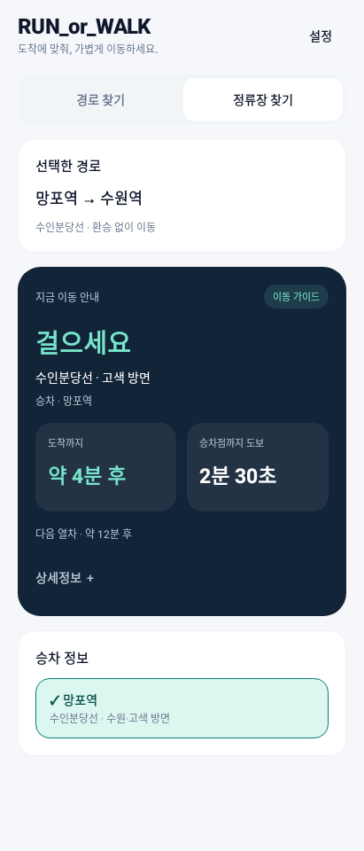
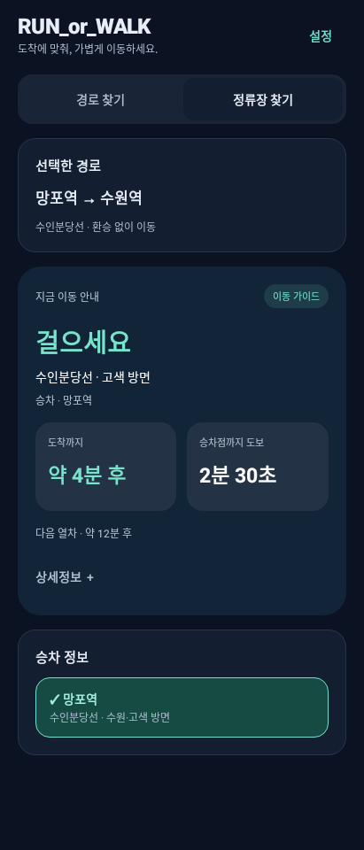
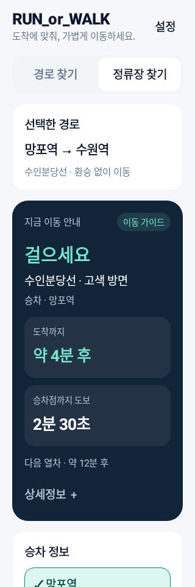

# 화면 디자인 정리

색상·타이포그래피·카드·간격을 통일하고, 이동 판단과 도착·도보시간에 시선이 모이도록 정리했다.

- 네이비 안내 카드, 민트 강조색, 밝은 중립 배경으로 주요 정보와 보조 정보를 구분했다. 다크 테마도 같은 기준을 적용한다.
- 이동 안내 문구와 시간 수치를 키우고, 도착시간·승차점까지 도보시간을 같은 크기의 영역에 배치했다.
- 작은 화면이나 큰 글씨에서는 두 시간 영역을 세로로 배치해 값이 잘리지 않도록 했다.
- 설정을 상단 버튼과 하단 패널로 옮겼다. 보행 프리셋·GPS 보정·여유시간 설정을 그대로 사용할 수 있다.
- 확정된 승차 정보와 선택한 경로를 간략히 보여준다. 정류장·방향 변경과 다른 경로 보기는 사용자가 펼쳐 확인한다.
- 선택 항목, 안내·오류 메시지, 검색 입력, 지도 제목, 전체 여백을 같은 스타일로 맞췄다.
- 기기 테마에 맞는 상태표시줄·탐색 표시를 위해 Activity의 edge-to-edge 설정을 적용했다.

검증:

- Kotlin 컴파일·디버그 APK 빌드 성공. 기존 회귀 검증 94개 모두 통과했다.
- Robolectric Android SDK35에서 밝은 테마, 어두운 테마, 320dp 화면·글씨 130%의 공통 컴포넌트를 렌더링해 확인했다.
- 탭 전환, 상세정보 열기·닫기, 설정 패널 열기, 보행 프리셋 변경을 확인했다.
- 실제 지도 SDK와 물리적 휴대폰 전체 화면을 원격 조작한 검증은 아니다. 아래 이미지는 실제 공통 Compose 컴포넌트를 샘플 이동 데이터로 조합한 디자인 미리보기다. 실시간 API 수신 증거 이미지와 구분한다.
- 추가 테스트 코드·의존성은 저장소에 넣지 않았다.

## 밝은 화면

## 어두운 화면

## 작은 화면과 큰 글씨

새 디자인 적용에는 최신 코드로 APK를 다시 빌드·설치해야 한다. Worker 재배포는 필요 없다.
