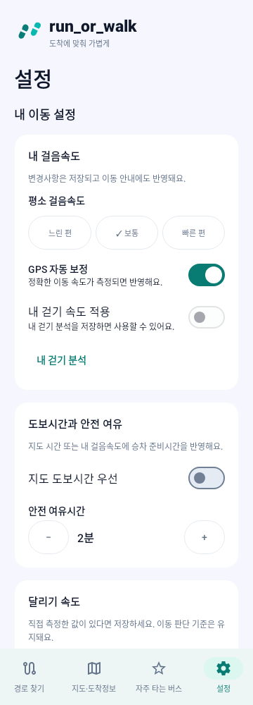
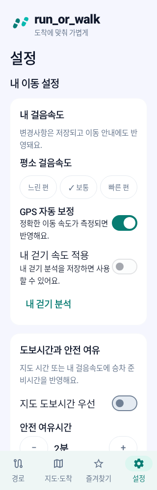
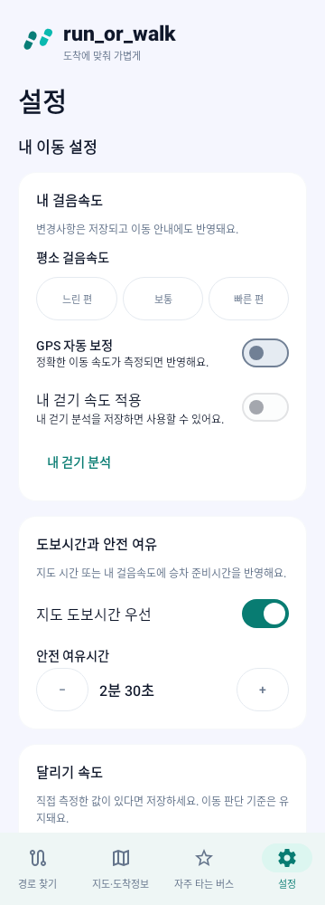
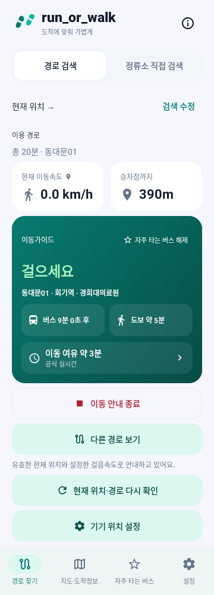

# 도보 연결과 설정 화면 개선 — 2026-10-28

기준: `900284523b284ea493ad8b1c53e9e52182ae0084`  
브랜치: `fix/walking-access-guidance-20261028`

## 확인된 원인

1. `AccessFallbackPolicy.requiresTransitAccess`에는 30km 조건 이외에 **3km 초과 또는 1시간 초과도 도보 범위 밖으로 판단하는 조건**이 있었다. `AutoGuidance`와 화면/지도 조회 분기에 공통으로 적용되어 정상 도보시간·거리가 있어도 UNKNOWN을 만들 수 있었다.
2. 지도 접근 경로 조회는 `searchWalk` 결과의 좌표만 저장했다. 같은 GPS→승차점의 실제 도보 경로라도 시간·거리가 `walkRoute`/`guidanceWalkingRoute`에 연결되지 않았다.
3. 도보 갱신은 유효한 GPS 스트림 관측이 있어도 별도 일회성 GPS 조회를 기다렸다. 추가 조회 실패로 계산을 불필요하게 지연할 수 있는 경로가 있었다.
4. 경로 탭의 브랜드 헤더 아래에 현재 선택된 교통수단·역·방향을 다시 표시했다. 설정 탭은 추가 설정 버튼→시트→세부 설정 버튼을 거쳐야 일부 항목을 수정할 수 있었다.

수정 전 도보 재현 테스트 3개가 모두 실패했고, 설정 탭 직접 접근 재현 테스트 1개도 실패했다.

## 수정 내용

- 3km·1시간의 사전 차단을 제거했다. 직선거리 30km 이하에서는 실제 도보 경로 조회를 시도하며, 30km 초과 또는 제공기관의 실제 NO_ROUTE 응답이면 기존 대중교통 접근 대안을 사용한다. **30km 이하라는 이유만으로 실제 보행 가능을 확정하거나 거리/시간을 생성하지 않는다.**
- 실제 도보 결과의 거리·제공기관 시간·좌표·수신시각을 함께 저장한다. GPS→지정 출발지 경로가 실제 승차점까지 연결될 때만 기존 도보 판단에 재사용한다.
- 출발지와 실제 승차점이 다르면 파란 경로의 시간을 승차점 시간으로 바꾸지 않는다. 실제 승차점의 도보 경로는 별도로 조회한다.
- 지도에 유효한 GPS→출발지 도보 경로가 있으면 `현재 위치 → 출발지 · 도보 약 N분 · Nm`를 표시한다. 대중교통 좌표나 참고용/만료된 경로로 도보 수치를 만들지 않는다.
- 기존 GPS 스트림의 유효한 관측을 먼저 사용하고, 없으면 일회성 위치 조회를 한다.
- 캐시된 지도 경로를 재사용해도 원래 수신시각과 120초 수명을 유지한다. 출발지 변경·25m 초과 GPS 이동·만료·참고 경로는 재사용하지 않는다.
- 경로 찾기 탭의 브랜드 헤더 아래 교통수단·역·방향 중복 표시를 제거했다. 이동가이드와 지도·도착정보의 실제 노선 정보는 유지한다.
- 설정 탭에 걸음속도, GPS 자동 보정, 분석 속도 적용, 지도 도보시간 우선, 안전 여유시간, 달리기 속도 입력을 바로 표시한다. 중간 설정 버튼과 세부 설정 접기를 제거했다.
- 기존 저장 및 실행 중 서비스에 설정을 전달하는 콜백은 유지했다. 측정한 개인 속도가 없으면 해당 적용 스위치는 비활성화하고 분석 진입 버튼을 제공한다.

## 변경 파일

| 파일 | 변경 |
|---|---|
| `AccessFallbackPolicy.kt` | 실제 30km 범위 기준으로 사전 조회 분기 수정 |
| `WalkingAccessPolicy.kt` | 실제 도보 결과 저장·지도 결과의 승차점 재사용 검증 |
| `JourneyScreenState.kt` | 지도 도보 결과의 원래 거리·시간·수신시각 보관 |
| `MainActivity.kt` | 지도·안내 도보 연결, 유효 GPS 우선 사용, 도보 수치 표시, 경로 헤더 중복 제거 |
| `JourneySettingsPanel.kt` | 모든 설정을 인라인 카드로 제공 |
| `DashboardScreen.kt` | 중간 설정 화면 제거, 기존 설정 저장·서비스 반영 유지 |
| `WalkingAccessRangeRegressionTest.kt` | 거리 제한/긴 도보시간/지도 재사용/만료·선택 변경·서비스 판단 회귀 |
| `SettingsInlineUiTest.kt` | 실제 루트 Compose의 설정 직접 접근·변경·저장 및 헤더 제거 확인 |
| `WalkingAnalysisUiTest.kt` | 새로운 인라인 설정 배치에서 기존 입력·저장·오류 검증 유지 |

## 검증 결과

```bash
./gradlew :app:compileDebugKotlin :app:testDebugUnitTest :app:assembleDebug
```

- **256개 통과, 실패 0, 오류 0, 건너뜀 0. Kotlin 컴파일 및 APK 빌드 성공.**
- 기존 246개 + 새 도보 회귀 7개 + Compose 3개다. 외부 일회성 테스트 sourceSet 없이 실행했다.
- 4km 정상 도보, 20km·장시간 도보, 30km 초과 분기, 화면/서비스의 동일 도보 판단을 검증했다.
- 지도 실제 결과 재사용 시 거리·시간과 원래 수신시각을 유지하고, 다른 승차점·출발지 변경·만료·참고 경로는 재사용하지 않는 것을 확인했다.
- 설정의 GPS 자동 보정/지도 시간 우선/안전 여유를 직접 변경하고 새 Store 조회에서도 같은 값이 저장됐는지 확인했다. 달리기 속도 입력·저장·범위 오류·초기화의 기존 테스트도 통과했다.
- 360dp 및 320dp·글자 130%에서 실제 Compose를 렌더링했다. 서로 다른 Robolectric Application을 기본 ViewModel factory가 참조해 발생한 테스트 격리 문제는 현재 테스트 Application의 factory를 명시해 해결했다. 제품 저장 로직을 우회하거나 검증을 제거하지 않았다.
- 기존 버스·지하철 ETA/갱신 연속성, 다음 차량 판단, 진동, 서비스 전환·백그라운드 회귀를 함께 통과했다.

## 실제 Compose 모의 렌더

다음은 수정한 실제 Compose 코드의 Robolectric 렌더다. 실제 기기·운영 API 캡처가 아니다. 설정은 한 화면 안에서 세로 스크롤하며 추가 화면/펼침 버튼 없이 수정한다.

| 설정 360dp | 설정 320dp·글자 130% | 세부 항목 직접 수정 |
|---|---|---|
|  |  |  |



## 범위와 남은 확인

이동 여유시간 기준·진동 정책·ETA 수명·지도 선 색상·기존 경로 검색·공식 API 검증은 유지했다. Worker 소스/캐시/예산/키 설정과 운영 배포는 변경하지 않았다. main 병합은 하지 않았다.

이번 검증은 모의 데이터와 기존 회귀 테스트다. 실제 휴대폰의 해당 출발지/목적지에서 지도 API가 유효한 도보 응답을 반환하는지와 GPS 이동 중 거리 갱신은 추가 확인이 필요하다. API의 경로 미제공/인증 오류가 있으면 이를 정상 거리로 바꾸지 않는다. 새 APK 설치가 필요하며 Worker 재배포는 필요하지 않다.

APK: `app/build/outputs/apk/debug/app-debug.apk`. [검증 수치 및 APK SHA-256](proof/walking-settings-20261028/validation.json).
